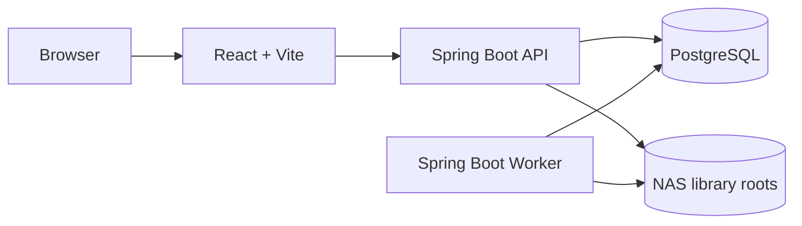

<div align="center">


# BookKin

**让好书相聚，让阅读归于自己。**

Self-hosted family library · EPUB & PDF · Private reading notes

开源、自托管的家庭电子书库与个人藏书管理平台，让家人的书籍、阅读进度与私人笔记各得其所。

[](https://github.com/johntao2004/BookKin/actions/workflows/docker.yml)
[](LICENSE)
[](apps/server/pom.xml)
[](apps/web/package.json)
[](#产品功能)

[产品功能](#产品功能) · [快速开始](#快速开始) · [目录导航](#目录导航) · [开发验证](#开发验证)

</div>

BookKin 将 NAS 上的 EPUB 与 PDF 整理成家人的数字书架：共享藏书，分别保存阅读进度与私人笔记。Book + Kin，书与家人相聚。

## 产品功能

| 场景 | 能力 |
| --- | --- |
| 整理藏书 | 书籍检索、分类、书单、元数据校对与自定义封面 |
| 沉浸阅读 | EPUB / PDF 在线阅读、阅读位置、书签、划线与笔记 |
| 家庭共享 | 主人、管理员与成员角色；阅读数据按用户隔离 |
| 安全入库 | 流式上传、SHA-256 去重、解析与人工确认 |
| NAS 管理 | 扫描、文件指纹、操作预览、回收站与审计 |
| 虚拟书楼 | 在三维书楼中探索书架与真实馆藏 |
| 自主部署 | React 前端、Java API / Worker、PostgreSQL 与 Docker Compose |

BookKin V1 仅支持 EPUB 与 PDF。注册默认关闭，主人可在安全设置开启；自行注册仅创建成员账户。邮件仅用于找回邮箱验证、密码重置和主人 SMTP 配置测试。禁书区使用身份验证器 TOTP 二次验证，普通登录保持现状。当前不支持 OAuth、有声书、漫画或 OCR。

## 系统架构



The API and Worker come from the same modular-monolith artifact. Long-running scans and file transactions stay outside HTTP request threads, while PostgreSQL stores accounts and catalog state and the NAS remains the source of truth for book files.

## 快速开始

### Requirements

- Node.js 22+
- pnpm 10+
- Java 21
- PostgreSQL 18

### Local development

Create the local database once:

```bash
brew install postgresql@18
brew services start postgresql@18
createuser --login bookkin
createdb --owner=bookkin bookkin
psql postgres -c "alter role bookkin password 'bookkin-local-dev'"
```

Install dependencies and start with an empty library. Normal setup never creates sample books, accounts or reading activity.

```bash
pnpm install
```

Start the complete local preview in the background (API, Worker and web):

```bash
pnpm start:preview
pnpm status:preview
# Stop processes created by this launcher:
pnpm stop:preview
```

The launcher waits for API health and the web CSRF proxy, reuses healthy services, and detaches newly started processes from the terminal. Logs are in `.local/logs/`. Closing the terminal does not stop the preview. It does not install a system service or start automatically after a reboot. Already running services reused by this launcher remain under their original owner; stop those through their original launcher.

For foreground debugging, `pnpm start:local` and `pnpm dev` remain available in separate terminals; closing either terminal stops that part of the stack.

Open `http://localhost:4173/setup` to create the owner account. After setup, upload your own EPUB/PDF files. Test-only fixture commands are documented in `scripts/fixtures/README.md` and are never part of initialization.

`pnpm start:local` builds the backend and runs immutable JAR snapshots from `.local/run`, so a later Maven build cannot replace archives already being read by the JVM.

### Docker Compose

```bash
cp .env.example .env
# Set a strong POSTGRES_PASSWORD in .env
docker compose up --build
```

For production, expose BookKin only through a trusted LAN or VPN and mount the intended NAS directory explicitly.

## Safety and privacy

- Reading positions, bookmarks, highlights and notes are isolated by user and are not visible to owners or administrators by default.
- Members cannot modify original NAS files. Owner/admin writes require a preview, expected fingerprint and idempotency key; permanent cleanup is owner-only.
- Uploads stream into `.bookkin-staging/uploads` and enter the formal library only after parsing and confirmation.
- 普通书籍暂不支持新增书库或跨书库移动；扫描不会自动改写 NAS 原文件。
- Book files, upload staging data and cover binaries stay on disk rather than in PostgreSQL.

### Optional Zhipu AI provider

The Zhipu OpenAI-compatible provider is disabled by default and makes no external requests unless both the global AI service and the provider are enabled. Configure it through the API/Worker environment; keep the API key private and retain the existing instance-specific `BOOKKIN_AI_SETTINGS_ENCRYPTION_KEY` for encrypted saved settings.

```bash
BOOKKIN_AI_ZHIPU_ENABLED=false
BOOKKIN_AI_ZHIPU_BASE_URL=https://open.bigmodel.cn/api/paas/v4/
BOOKKIN_AI_ZHIPU_API_KEY=
BOOKKIN_AI_ZHIPU_MODEL=glm-4.7-flash
```

The owner can also configure the endpoint, model and key in 管理设置 → 外部服务 → AI. A blank key keeps the saved key; the UI never returns a saved key in settings responses.

## 目录导航

```text
apps/web/       前端：React、TypeScript、Vite、Ant Design
apps/server/    后端：Java 21、Spring Boot、Flyway、jOOQ
design/         Design tokens, Figma scope and dated visual QA
docs/           Architecture, operations, ADRs and OpenAPI
docker/         Production image and multi-root example
ops/            Backup and restore utilities
scripts/        开发脚本：本地启动、演示数据、Token 生成
scripts/benchmark/  性能测试脚本与专用 SQL
```

本地验证记录存放于 `.local/`，构建快照存放于 `.artifacts/`；两者均不纳入 Git 同步。

## 开发验证

```bash
pnpm lint
pnpm typecheck
pnpm test
pnpm build

cd apps/server
./mvnw verify
```

The design-token source of truth is [`design/tokens.json`](design/tokens.json). After changing it, run `pnpm generate:tokens` and review the corresponding Figma variables.

## 文档

- [OpenAPI 接口定义](docs/openapi/bookkin-api.yaml)
- [数据库运维文档](ops/database/README.md)
- [发布运维文档](ops/release/README.md)
- [多书库 Compose 示例](docker/compose.multi-root.example.yaml)
- [虚拟书楼说明](scripts/hogwarts-library/README.md)

## License

BookKin source code is available under the [MIT License](LICENSE). Bundled fonts, artwork and models retain their own licenses and source notices in `apps/web/public/`; see [font sources](apps/web/public/fonts/FONT_SOURCES.md) and [虚拟书楼资源说明](scripts/hogwarts-library/README.md).

### 邮件与密码找回

主人在「设置 → 邮件服务」填写 SMTP 主机、端口、连接加密、用户名、授权码、发件邮箱和 BookKin 站点地址，启用并保存后向自己的邮箱发送测试邮件。支持 STARTTLS（通常 587）与 TLS（通常 465）；不加密模式只允许本机测试。授权码加密存储，留空保存会保留原值。使用实例已有的 `BOOKKIN_AI_SETTINGS_ENCRYPTION_KEY`，部署后需持续保留此密钥。

用户在「设置 → 找回邮箱」输入当前密码和邮箱，通过邮件中的链接确认绑定。登录页「忘记密码？」向已验证邮箱发送 30 分钟有效的一次性链接；重置成功撤销旧会话，需要重新登录。不存在或停用的账户使用相同申请响应。发送失败可由主人通过测试邮件检查 SMTP 配置，服务端记录重置投递失败审计。

邮件中的站点地址必须为可访问的 HTTPS 根地址；本机测试可使用 `http://127.0.0.1:4175`。`BOOKKIN_WEB_PORT=4175 pnpm start:preview` 可选择空闲的本地端口，成功启动后会记住该端口供后续启动和状态检查使用。用户仍处于临时密码状态时，需要先设置自己的密码才能管理邮件配置或绑定邮箱。

来源地址默认取 TCP 对端，忽略 `Forwarded` 和 `X-Forwarded-*`，用于初始化网络限制、限流及登录审计。站点链接通过 `BOOKKIN_PUBLIC_BASE_URL` 配置，HTTPS 部署同时设置 `BOOKKIN_COOKIE_SECURE=true`。如需反向代理恢复真实客户端地址，必须先限制应用仅接受可信代理连接，并在代理清除外部转发头、配置精确可信代理范围；不得直接将 `server.forward-headers-strategy` 改为无来源校验的 `framework`。

### 密码复杂度

主人可在「用户管理 → 安全设置 → 密码复杂度」配置最小长度（8–128）以及大写字母、小写字母、数字、英文标点/符号要求。默认延续至少 12 位；密码最多 200 位。注册、主人初始化、首次改密与邮件重置共享服务端校验和页面提示。自动临时密码满足当前规则。规则变更只影响新设置的密码，不会阻止已有密码登录。密码规则与开放注册分别保存。
