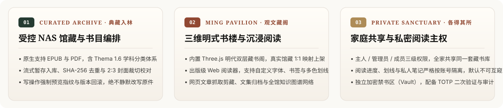
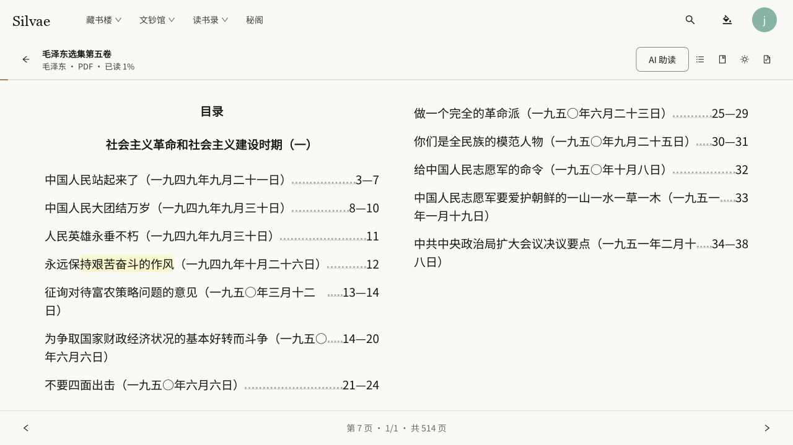
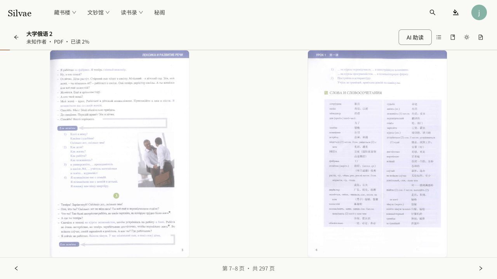
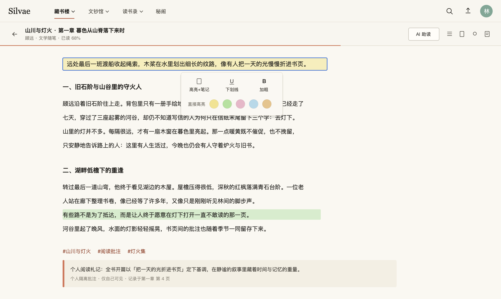
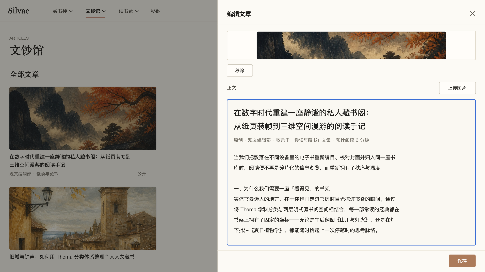
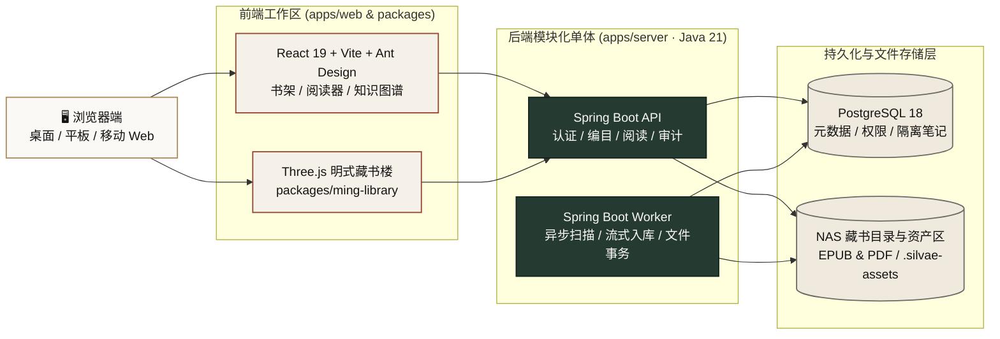

<div align="center">


<br />

[](https://github.com/johntao2004/Silvae/actions/workflows/docker.yml)
[](LICENSE)
[](apps/server/pom.xml)
[](apps/web/package.json)
[](packages/ming-library/README.md)
[](compose.yaml)
[](#核心特性与界面预览)

**[项目理念](#名称溯源--why-silvae) · [核心特性与预览](#核心特性与界面预览) · [系统架构](#系统架构) · [快速开始](#快速开始) · [安全与隐私](#安全边界与运维配置) · [目录结构](#目录结构) · [开发验证](#开发与验证)**

</div>

<br />

<div align="center">
  
</div>

<br />

## 名称溯源 · Why Silvae

> **书林成荫，藏阅归心。**
>
> **Silvae**（读音 `/ˈsɪl.viː/`，中文名 **「书林」**）源自古典拉丁语中 *Silva*（森林）的复数形式。两千年前，古罗马学者与诗人斯塔提乌斯（Statius）以及近代哲学家培根（Francis Bacon）便以 ***Silvae*** 命名自己毕生珍藏的典籍文集——因为人类最早的书页本就取自林木，每一部被珍藏的著作都是一棵封存着思想的古木。在东方，宋明刻书与藏书胜地亦被称为 **「建阳书林」**。
>
> **Silvae · 书林** 将散落在家庭 NAS 中的 EPUB 与 PDF 化作一座静谧的数字藏书阁：全家人共享同一片丰茂的书林，而每个人的阅读进度、划线批注与私人笔记则严格归于自己。

## 核心特性与界面预览

| 领域模块 | 核心能力说明 |
| :--- | :--- |
| **📚 馆藏编目与检索** | 专注支持 **EPUB** 与 **PDF** 两种核心格式；内置 **Thema 1.6** 国际标准学科分类体系、多维高级筛选、自定义书单、在线元数据补全（Open Library / Wikidata / Google Books）与 **2:3 封面裁切校对**。 |
| **📖 沉浸式双引擎阅读** | 内置出版级 Web 端 EPUB / PDF 阅读器，支持自定义阅读字体上传、书签、多色高亮划线、Markdown 格式阅读笔记、公开/私密书评，以及多端翻页状态自动同步（Last-Write-Wins）。 |
| **🏯 三维明式虚拟书楼** | 内置基于 Three.js 构建的 **「观文藏阁 · 明代宫殿藏书楼」**（`packages/ming-library`），将真实业务馆藏 1:1 映射为三维书架上的实体书册，支持第一人称空间漫游、分类书架定位与即点即读。 |
| **🕸️ 文章剪藏与知识图谱** | 支持网页文章抓取净化、Markdown 在线编辑、文集归档与阅读批注；提供跨书籍、术语与笔记的 **知识图谱可视化网络（Knowledge Graph）**。 |
| **👨‍👩‍👧 家庭共享与隐私隔离** | 划分 **主人（Owner）**、**管理员（Admin）** 与 **成员（Member）** 三级角色；全家共享同一套藏书目录，但每名成员的阅读位置、书签、划线与私人笔记严格按账号隔离，**默认对主人和管理员不可见**。 |
| **🔐 加密禁书区（Vault）** | 针对受限或私密馆藏提供独立 **禁书区**，采用身份验证器 **TOTP 二次验证** 与密钥信封加密保护，与日常书架权限严格解耦。 |
| **🛡️ 受控 NAS 文件安全** | 上传文件先流式写入 `.silvae-staging/uploads` 暂存，经 SHA-256 哈希去重、解析与人工确认后方才落盘；任何 NAS 写操作均需经过预览、校验 `expectedFingerprint` 与幂等键，配备版本备份、回收站与完整审计日志，**扫描任务绝不静默改写或移动 NAS 原文件**。 |

### 1. 书林总览 · 馆藏编目与多维检索

支持按阅读状态、Thema 学科分类、文件格式与标签快速筛选，自动汇总在读进度与最近阅读记录：

<p align="center">
  
</p>

### 2. 沉浸式双引擎阅读器 · EPUB 目录导读与 PDF 双页展阅

提供纸感暖调排版、左侧章节目录抽屉、版面缩放与 PDF 双页并排展阅体验：

<table>
  <tr>
    <td width="50%" align="center">
      
      <br />
      <sub><b>章节目录抽屉与纸感排版</b></sub>
    </td>
    <td width="50%" align="center">
      
      <br />
      <sub><b>PDF 原版版式双页并排展阅</b></sub>
    </td>
  </tr>
</table>

### 3. 私人批注与文章精读工作台

支持选中文本多色高亮、右侧批注面板同步回溯，以及网页文章采集净化与 Markdown 在线编辑：

<table>
  <tr>
    <td width="50%" align="center">
      
      <br />
      <sub><b>多色高亮划线与个人隔离批注</b></sub>
    </td>
    <td width="50%" align="center">
      
      <br />
      <sub><b>文章文集归档与双栏精读批注</b></sub>
    </td>
  </tr>
</table>

## 系统架构

Silvae 采用 **Modular Monolith（模块化单体）+ 独立后台 Worker** 架构：API 服务与后台 Worker 由同一套构建制品按不同 Spring Profile（`api` / `worker`）启动。耗时长的 NAS 目录扫描、文件事务写回与上传解析完全脱离 HTTP 请求线程；PostgreSQL 18 负责存储账户、目录与阅读状态，而书籍原文件、暂存文件与封面资产始终保留在磁盘/NAS 文件系统中。



## 快速开始

### 1. Docker Compose 部署（推荐 NAS / 生产环境）

复制环境变量模板并设置高强度数据库密码，挂载 NAS 书籍目录后一键启动 API、Worker 与 PostgreSQL 服务：

```bash
cp .env.example .env
# 编辑 .env，设置高强度 POSTGRES_PASSWORD 与挂载路径 SILVAE_LIBRARY_MAIN
docker compose up --build -d
```

> **生产安全提示**：请仅在受信任的局域网（LAN）或 VPN 内暴露 Silvae 服务，并在 `.env` 中显式指定 NAS 挂载目录与持久化的 `SILVAE_AI_SETTINGS_ENCRYPTION_KEY`、`SILVAE_TWO_FACTOR_ENCRYPTION_KEY`。

### 2. 本地开发与一键预览

#### 环境要求

- **Node.js** `22+` & **pnpm** `10+`
- **Java** `21`
- **PostgreSQL** `18`

#### 初始化本地数据库（首次执行）

```bash
brew install postgresql@18
brew services start postgresql@18
createuser --login silvae
createdb --owner=silvae silvae
psql postgres -c "alter role silvae password 'silvae-local-dev'"
```

#### 安装依赖并启动后台完整预览栈

常规初始化不会预置任何测试书籍、账号或阅读记录，始终从干净的空书库起步：

```bash
pnpm install

# 在后台启动完整预览栈（API + Worker + Web 前端）
pnpm start:preview

# 查看运行状态与端口
pnpm status:preview

# 停止由该启动器创建的后台进程
pnpm stop:preview
```

- **首次初始化**：启动后访问 `http://localhost:4173/setup` 创建 **主人（Owner）** 账户，随后即可上传你自己的 EPUB / PDF 藏书。
- **自定义端口**：可通过 `SILVAE_WEB_PORT=4175 pnpm start:preview` 指定空闲端口，启动器会自动记住该端口供后续状态检查使用。
- **进程与日志隔离**：`pnpm start:preview` 会等待 API 健康检查与前端 CSRF 代理就绪，并将进程与当前终端解耦（关闭终端不会中断服务，日志位于 `.local/logs/`）。`pnpm start:local` 会从 `.local/run` 运行不可变 JAR 快照，防止后续 Maven 编译覆盖正在被 JVM 读取的归档。如需前台调试，可在独立终端分别运行 `pnpm start:local` 与 `pnpm dev`。

## 安全边界与运维配置

### 数据主权与文件安全边界

- **阅读隐私默认隔离**：阅读进度、书签、划线高亮和笔记按用户 ID 严格隔离，主人和管理员默认无法查看其他成员的私人阅读数据。
- **NAS 原文件受控保护**：普通成员无权修改 NAS 原文件；主人与管理员的写操作必须先经过预览并持有 `expectedFingerprint` 与幂等键，永久清理仅限主人执行。普通书籍当前固定使用默认主书库，不自动跨书库移动或静默重命名原文件。
- **功能边界说明**：Silvae V1 专注打磨 EPUB 与 PDF 阅读体验；注册默认关闭（主人可在安全设置中开启，自行注册仅创建 `MEMBER` 账户）；禁书区采用 TOTP 身份验证器二次验证；当前不包含 OAuth、有声书、漫画或 OCR。

<details>
<summary><b>🔐 密码复杂度与注册策略配置（点击展开）</b></summary>
<br />

- 主人可在 **「用户管理 → 安全设置 → 密码复杂度」** 中配置最小长度（`8–128` 位，默认至少 `12` 位，上限 `200` 位）以及大写字母、小写字母、数字、英文标点符号要求。
- 开放注册、主人初始化、首次登录改密与邮件重置均执行同一套服务端校验规则，并在前端实时展示未满足项。
- 自动生成的临时密码默认满足当前复杂度规则；修改规则仅约束新设置的密码，不会阻断已有账户正常登录。密码策略与开放注册开关支持分别独立保存。

</details>

<details>
<summary><b>✉️ SMTP 邮件服务与密码找回配置（点击展开）</b></summary>
<br />

- **主人配置与测试**：主人在 **「设置 → 邮件服务」** 中填写 SMTP 主机、端口、加密方式（支持 `STARTTLS` 587 或 `TLS` 465，不加密模式仅限本机测试）、用户名、授权码、发件邮箱及 Silvae 站点根地址，保存后可向自己发送测试邮件。授权码采用 `SILVAE_AI_SETTINGS_ENCRYPTION_KEY` 加密存储，留空保存会自动保留已存密钥。
- **成员绑定与重置**：用户在 **「设置 → 找回邮箱」** 验证当前密码并发送确认链接完成绑定；登录页点击 **「忘记密码？」** 会向已验证邮箱发送 `30 分钟` 有效的一次性重置链接，重置成功后自动吊销旧会话。处于临时密码状态的账户需先完成首次改密后方可绑定找回邮箱。
- **反向代理与来源审计**：邮件中的站点地址须为可访问的 HTTPS 根地址（通过 `SILVAE_PUBLIC_BASE_URL` 配置，HTTPS 环境请同步设置 `SILVAE_COOKIE_SECURE=true`；本机测试可使用 `http://127.0.0.1:4175`）。服务端默认取 TCP 对端地址进行限流与登录审计，忽略未受信任的 `Forwarded` / `X-Forwarded-*` 头。

</details>

<details>
<summary><b>🤖 可选智谱 AI（OpenAI 兼容）辅助服务配置（点击展开）</b></summary>
<br />

AI 辅助能力默认完全关闭，除非同时开启全局 AI 开关与对应 Provider，否则服务端不会发起任何外部请求。可通过环境变量或在 **「管理设置 → 外部服务 → AI」** 中配置：

```bash
SILVAE_AI_ZHIPU_ENABLED=false
SILVAE_AI_ZHIPU_BASE_URL=https://open.bigmodel.cn/api/paas/v4/
SILVAE_AI_ZHIPU_API_KEY=
SILVAE_AI_ZHIPU_MODEL=glm-4.7-flash
```

请妥善保管并持久化实例专属的 `SILVAE_AI_SETTINGS_ENCRYPTION_KEY`；Web 端设置接口仅支持写入/留空保留密钥，绝不在响应中回传已保存的 API Key。

</details>

## 目录结构

```text
Silvae/
├── apps/
│   ├── web/                  # 前端应用：React 19、TypeScript、Vite、Ant Design
│   └── server/               # 后端服务：Java 21、Spring Boot、Flyway、jOOQ (API & Worker)
├── packages/
│   └── ming-library/         # 三维明式书楼：Three.js 0.180 独立场景包与宿主桥接
├── design/
│   └── tokens.json           # 设计系统唯一数据源（颜色、字阶、间距、明式书楼界面 Token）
├── docs/
│   ├── assets/               # 仓库主页视觉横幅与架构概览 SVG 资产
│   └── openapi/              # OpenAPI 接口契约 (silvae-api.yaml)
├── docker/                   # 生产容器镜像构建文件与多书库 Compose 示例
├── ops/                      # 数据库备份、恢复演练与发布脚本
└── scripts/                  # 本地预览启动器、Token 生成器、演示数据与性能基准脚本
```

> 本地运行日志与进程快照存放于 `.local/`，构建验证产物存放于 `.artifacts/`，两者均已配置 `.gitignore` 忽略。

## 开发与验证

修改设计 Token（[`design/tokens.json`](design/tokens.json)）后，请先运行 `pnpm generate:tokens` 同步生成前端样式与类型定义。提交代码前请执行完整的前后端验证流水线：

```bash
# 1. 前端代码检查、类型校验、单元测试与生产构建
pnpm lint
pnpm typecheck
pnpm test
pnpm build

# 2. 后端集成测试与契约校验
cd apps/server
./mvnw verify
```

## 相关文档

- 📄 [OpenAPI 接口规范 (`silvae-api.yaml`)](docs/openapi/silvae-api.yaml)
- 🏯 [三维明式书楼构建与宿主接入说明](packages/ming-library/README.md)
- 🏛️ [古建筑书楼几何与碰撞验证说明](scripts/hogwarts-library/README.md)
- 🗄️ [数据库备份、迁移与运维指南](ops/database/README.md)
- 🚀 [生产发布与密钥初始化指南](ops/release/README.md)
- 🐳 [多书库挂载 Docker Compose 示例](docker/compose.multi-root.example.yaml)
- 🔤 [内置字体来源与授权说明](apps/web/public/fonts/FONT_SOURCES.md)

## 开源许可

Silvae 源代码基于 [MIT License](LICENSE) 开源。随附的字体、美术贴图与三维模型资产各自保留其原始许可与署名声明，详见 [`apps/web/public/fonts/FONT_SOURCES.md`](apps/web/public/fonts/FONT_SOURCES.md) 与 [`packages/ming-library/THIRD_PARTY_NOTICES.md`](packages/ming-library/THIRD_PARTY_NOTICES.md)。
