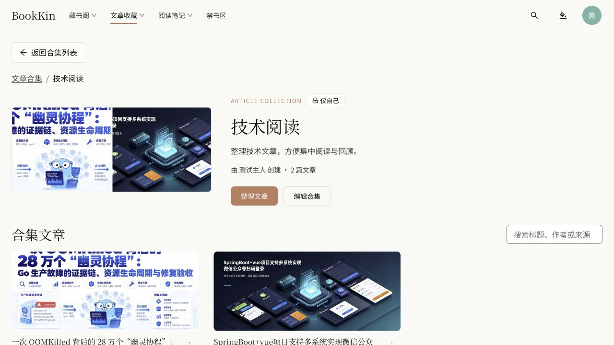
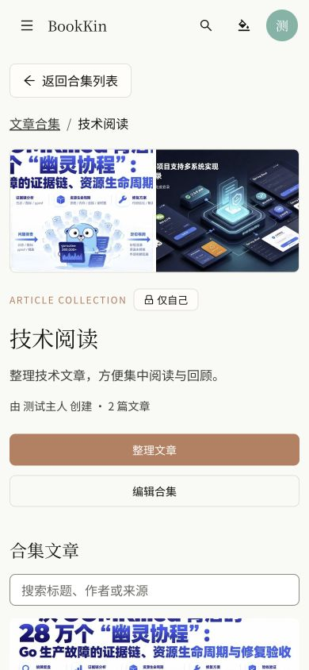

# 文章合集本地验收（2026-10-23）

文章收藏新增“合集”二级入口，列表与详情独立路由；文章卡片及阅读器可加入合集。支持创建、改名、说明、私人/成员共享、增删成员、顺序调整和删除合集。删除合集不删除原文章或私人阅读数据。前后端使用独立的合集写权限与 revision 冲突校验。

## 实际验证

- 本地 API/Worker 通过 `pnpm start:local` 的不可变 JAR 快照运行；新增 V28 仅建立文章合集及成员关系表。
- 后端 `./mvnw verify`：272 项，零失败/错误，9 项依赖 Docker 的测试跳过。合集真实 PostgreSQL 隔离 schema、认证和服务测试均实际执行通过。
- 前端 lint、类型检查、生产构建通过。合集定向测试 4 文件 / 11 项通过；初次测试的文本唯一匹配断言已修正为允许封面占位与标题同时出现。
- 前端全量首轮：174 文件，833 项通过、1 项上述断言失败；修正后的相关 11 项已独立复测全部通过，没有重复运行整套测试。
- 浏览器创建私人“技术阅读”合集，加入两篇已有技术文章，调整顺序并保存；刷新后两篇文章与顺序均保留。文章卡片“加入合集”入口可用，重复加入会显示提示。
- 390×844 手机宽度无横向溢出，返回按钮位于内容左上、面包屑之前；浏览器控制台无警告/错误。
- 未在浏览器执行删除确认或修改共享权限；这些行为由服务及隔离数据库测试覆盖。未提交、推送或部署生产。

