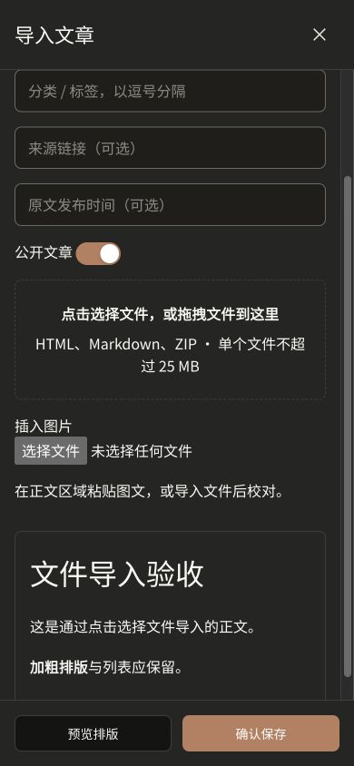

# 文章文件导入区验收

- 导入抽屉增加整块点击与拖放区域，原生按钮支持键盘操作。
- HTML/HTM、Markdown、ZIP 仍由 importArticle 解析和校验，单文件 25 MB；多文件拖入明确拒绝；导入期间禁止重复操作。
- 点击文件选择器在 http://127.0.0.1:4176/articles 实测导入合成 Markdown，标题、正文、加粗格式及预览正常；没有保存测试文章。
- 390px / 320px 手机宽度：导入区343px / 273px，抽屉无横向溢出，控制台无错误。
- 拖放路径通过组件事件测试验证，未实测从操作系统拖入文件。
- 相关组件与解析测试 5 项通过；完整前端检查 lint、typecheck、519 项测试及生产构建通过。

