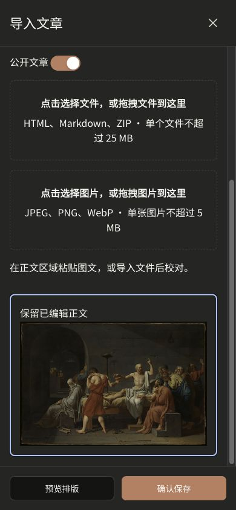

# 文章图片插入验收

- 图片区与文件导入区复用点击、键盘及拖放组件，单次一张，支持 JPEG/PNG/WebP，最大5MB。
- 图片解码成功后插入，读取失败、损坏图片和格式/体积错误均有提示。
- 插入时保留已编辑正文；预览和继续校对后图片保留。
- 浏览器实测JPEG插入及损坏PNG拒绝；390px手机图片宽约309px、无横向溢出。
- 拖放通过组件事件测试，未实测操作系统文件拖入。
- lint、typecheck、完整521项测试及生产构建通过。最终正文保留修正后，另跑7项相关测试通过。

