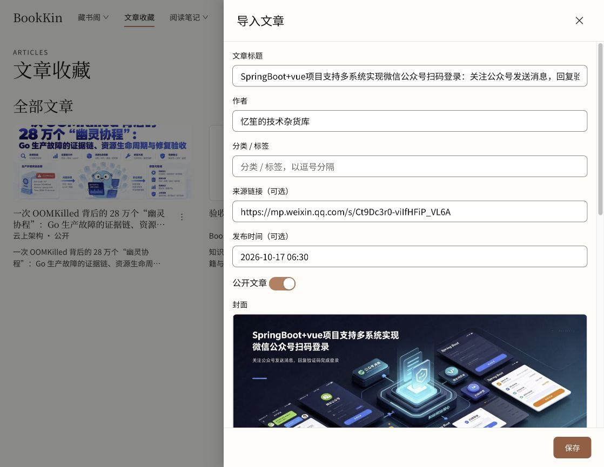

# 文章发布时间自动抓取

原文：[微信公众号文章](https://mp.weixin.qq.com/s/Ct9Dc3r0-viIfHFiP_VL6A)。

原先 `ArticleService.fetch` 将 `publishedAt` 固定设为空字符串。现从发布元数据、文章类型的 JSON-LD、发布时间元素及微信脚本变量提取；只解析数据，不执行网页脚本。无效值继续尝试其他来源，缺失时留空；排除明确标记的更新时间，微信脚本规则限定于微信域名。保留来源日期精度和时区，不给纯日期补造时间。

原文静态 `#publish_time` 为空，脚本含 `var createTime = '2026-10-17 06:30'`，另含时间戳 `1792189800`。新版本通过真实浏览器“新增文章 → 抓取预览”，自动回填 **2026-10-17 06:30**，标题、作者、来源及封面仍正常。控制台错误为 0，仅预览，未保存文章。

验证：

- `apps/server/./mvnw verify`：249 项，0 失败、0 错误，26 项因 Docker 不可用或未配置原生数据库测试环境跳过。
- 随后仅增加真实微信变量片段测试，`./mvnw -q -Dtest=ArticlePublicationTimeTest test`：8 项通过，无产品代码变化。
- `pnpm --filter @bookkin/web exec vitest run src/pages/ArticlesPage.test.tsx --maxWorkers=1 --pool=threads --testTimeout=60000`：15 项通过，覆盖自动回填及手动修订后保存。此前高负载下曾出现默认测试超时及 fork worker 启动超时。
- 使用 `pnpm start:local` 更新本地 API/Worker 不可变 JAR 快照，健康检查通过。未提交、推送或部署。

证据：
