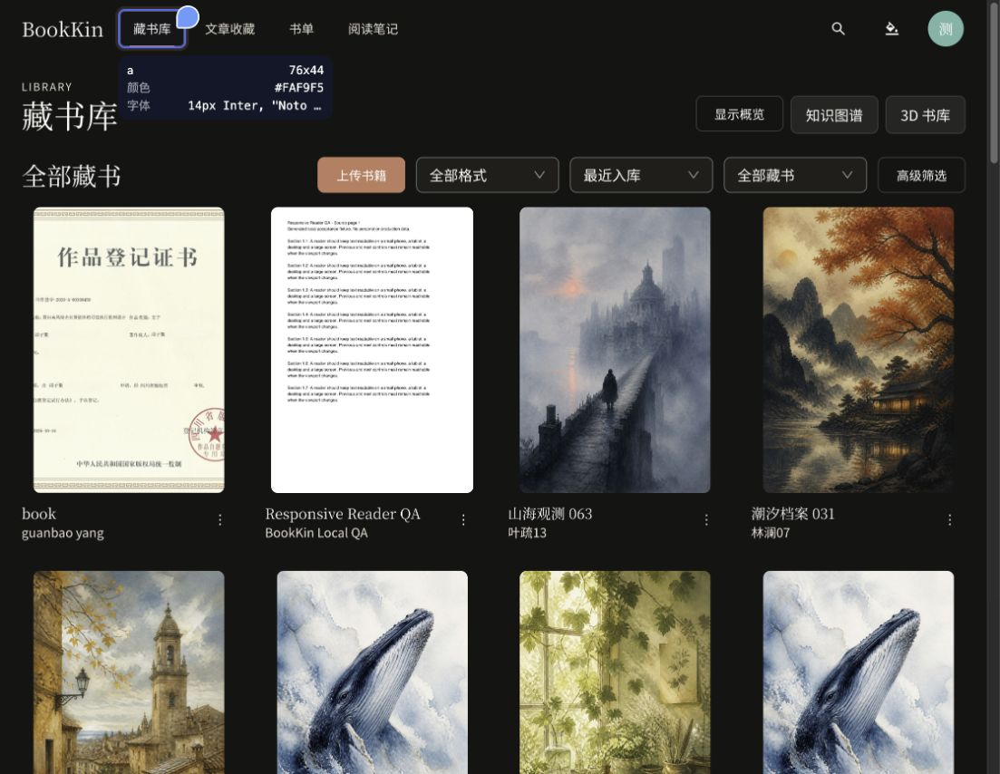

# 目录书卡比例调整

后续用户已明确选择统一铺满并允许边缘裁切，当前规则见[全局书籍封面视觉统一](./book-covers-unified-2026-10-22.md)。下文保留此前完整显示原图的历史验收记录。

根据 `/library` 浏览器批注，统一调整 `BookCardPresentation`，同时覆盖公开书库、普通藏书、书单及复用此组件的加密书籍卡片。

- 展示框由 2:3 改为 3:4，同一桌面列宽约 240px 时，框高由 360px 降到 320px。
- 书籍图片使用自然比例与最大宽高约束，居中完整显示，避免裁切和拉伸；圆角及阴影贴合实际图片边界。
- 骨架组件引用同一比例常量。文章仍使用 2.35:1 横版裁切展示；自定义封面的 2:3 裁切上传流程保持原样。
- 浏览器实测：800×1200 图片显示约 213×320；991×1403 图片显示约 226×320，均保留原始比例。
- 实际点击封面可进入书籍详情并返回藏书库；控制台未发现 error/warn。截图临时隐藏概览后已恢复原偏好。
- `pnpm lint`、`pnpm typecheck`、`pnpm test`（142 文件、640 项）及 `pnpm build` 通过。构建保留现有大资源包提示。
- 当前预览：`http://127.0.0.1:4176/library`；未提交、推送或部署。

