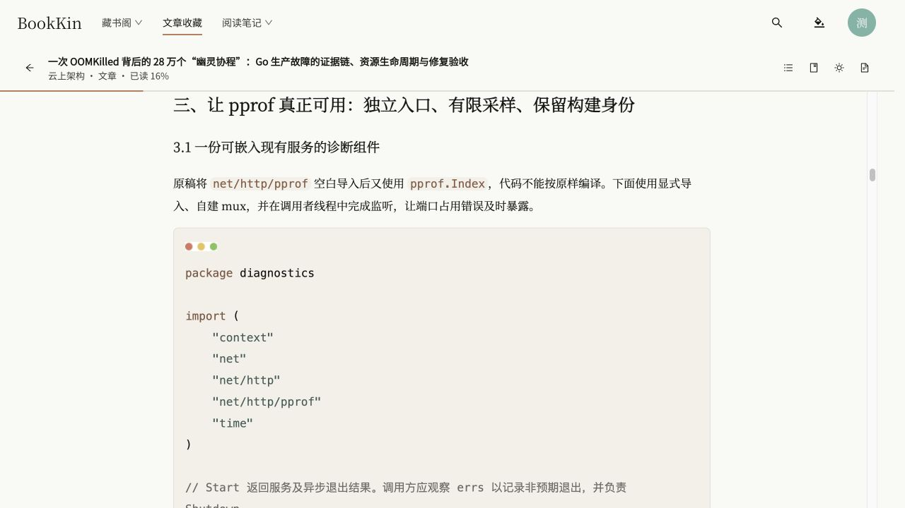
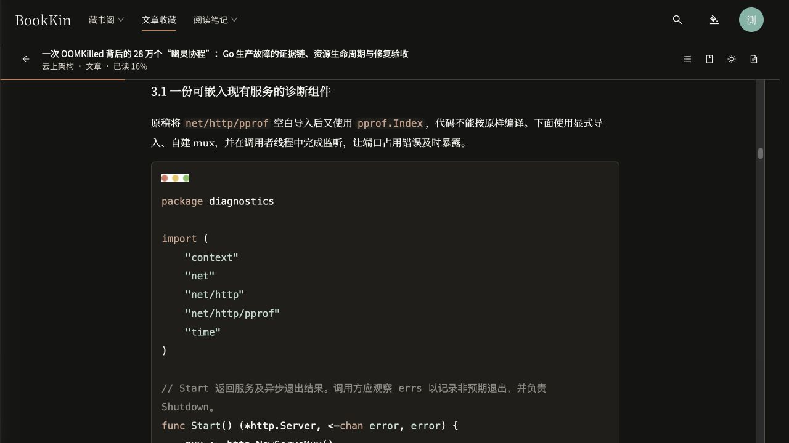

# 文章代码高亮与首行布局验收（2026-10-22）

## 实现

- 接入固定版本 highlight.js 11.12.0，仅打包注册 Bash、C++、CSS、Go、Java、JavaScript、JSON、Python、SQL、TypeScript、XML/HTML、YAML 语法及其别名，不加载 CDN，也不执行代码。
- 有语言声明时优先使用声明；未声明时在已注册语法中自动识别。未知语言、显式纯文本和超过 50,000 字符的块保持完整原文；单文档最多绘制 12,000 个语法范围。
- 原文中的三个圆点来自代码块内的装饰图片。将 `pre > code` 独立成块，确保首行位于装饰图片下方；保留已有空格、缩进和 BR 换行。
- 文章阅读器用 CSS Custom Highlight 范围绘制语法颜色，不插入 token 包装节点，不改写正文、段落 ID 或保存的 CFI；主题和批注变化后更新，并避开用户已批注文字的前景色。
- 文章 Markdown 预览及博文共用相同的高亮适配器和主题颜色；只处理已消毒的显示 HTML，不修改保存的文章内容或放宽图片/脚本清洗。
- 保留现有 EPUB/PDF 阅读呈现；不支持原生范围高亮的旧浏览器，文章阅读器降级为可读纯文本代码。

## 检查结果

- `pnpm lint`、`pnpm typecheck`、`pnpm build`：通过。构建仍有既有的大资源块提示。
- `pnpm test`：157 个文件、743 项全部通过。
- 相关复验：5 文件、19 项通过，含语言别名、转义脚本、未知/超长代码降级、BR 换行、真实 EpubCFI 前后相等、原文节点身份不变、批注文字颜色排除、旧浏览器降级及现有文章/博文清洗。
- 实际文章：`/articles/0402f1b4-c884-45e5-836c-e5f8199a471b`。Go 与 Shell 块高亮可见，20 个代码块的代码首行均低于装饰图片底部。
- 夜间与纸张主题检查：20 个代码块主题切换前后的原始 HTML 全部相等，颜色随主题更新。
- 390×844 手机模拟：文章文档视口与内容宽度均 336，无横向溢出；代码仍在圆点下方且可正常换行。已恢复原视口；未做物理手机验证。
- 开发热更新期间出现过依赖数组长度变化的 React 提示；最终新建、完整加载的预览页控制台错误为零。
- 未修改后端，未重跑 Maven；未提交、推送或部署。

## 来源与兼容性

- [highlight.js 官方说明](https://highlightjs.org/)
- [highlight.js 核心 API](https://highlightjs.readthedocs.io/en/latest/api.html)
- [CSS Custom Highlight API：不修改底层 DOM 的范围绘制](https://developer.mozilla.org/en-US/docs/Web/API/CSS_Custom_Highlight_API)

