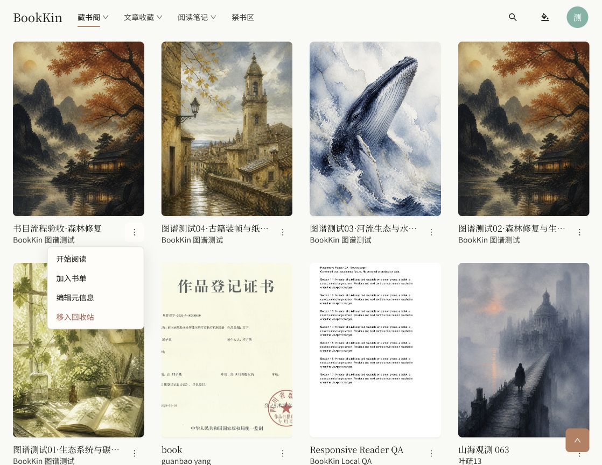
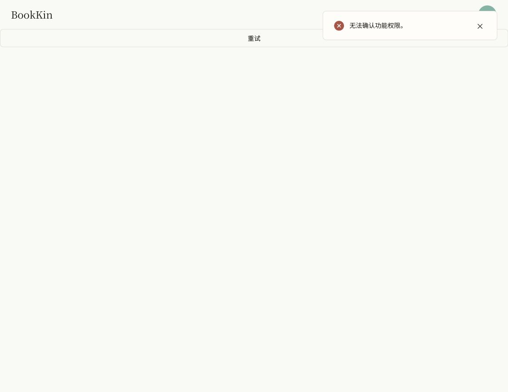
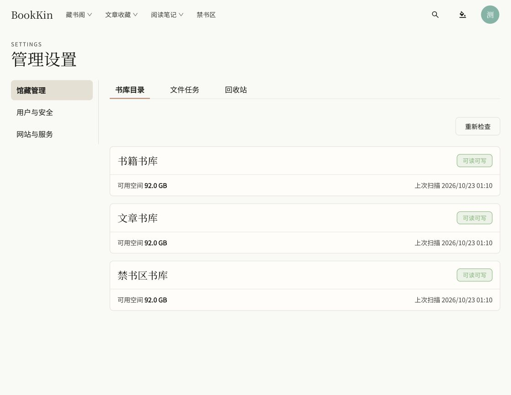

# 默认书库与移除移动书籍验收（2026-10-23）

## 实现

- 普通书籍沿用部署配置的默认书库；书库设置取消新增目录表单，保留实时状态与重新检查。
- 旧登记预览及登记提交端点返回 403 / LIBRARY_ROOT_REGISTRATION_DISABLED，不访问文件系统或写入目录。
- 书卡移除移动菜单；移动弹窗与目标书库选择流程移除，上传自动选中现有默认可写书库。
- 服务端 MOVE 预览、旧预览执行、旧幂等请求均受 BOOK_MOVE_DISABLED 拒绝；保留既有授权检查。
- 角色权限标签改为“重命名与写回文件”，原权限码与授权不变。
- 不修改已有目录、文件及任务历史；文章与禁书区继续独立存储。

## 浏览器

真实本地会话，http://127.0.0.1:4176：

- 藏书阁卡片菜单：开始阅读、加入书单、编辑元信息、移入回收站；不存在移动。
- 上传书籍：显示书籍书库可用容量，文件选择入口可用，无目标书库下拉；本次浏览器验收不上传或删除用户文件。
- 管理设置 → 馆藏管理 → 书库目录：普通书籍仅一个书库卡片，无新增按钮；另有独立文章及禁书区存储卡片。
- 更新不可变 API/Worker JAR 后刷新页面成功，健康检查 UP，当前页面控制台无警告或错误。

## 自动验证

- lint、typecheck、git diff --check 通过。
- 后端 ./mvnw verify：275 项，失败 0、错误 0，9 项依赖 Docker 的测试跳过。本次新增/更新的 5 项禁用功能测试全部实际执行通过。
- 前端生产构建通过（保留现有大体积 chunk 提示）。
- 前端全量：175 文件，173 通过、2 失败；836 项，833 通过、3 失败。失败为 App.test.tsx 两个阅读笔记页标题断言，以及 table-pagination.test.tsx 一次 15 秒超时。
- 单独复测：本次涉及的 BookCard、FileOperationDialog、BookUploadDialog、LibraryRootsPage、permissions 共 5 个测试文件全部通过；分页测试也复测通过。7 文件组合复测为 6 文件通过、1 文件失败，43 项通过、8 项失败；8 项失败全部位于本次未修改的 App.test.tsx，涉及阅读笔记、概览和文章页标题断言。测试期间该文件及页面文案存在其他并行修改，不把这些失败当作本次功能验收通过，也不覆盖其他任务的修改。
- 不宣称全量前端回归通过；完整输出保留在 default-library-tests.log 与 default-library-focused.log。
- 日志位于 .local/logs/default-library-*.log；本次未提交、推送或部署。
