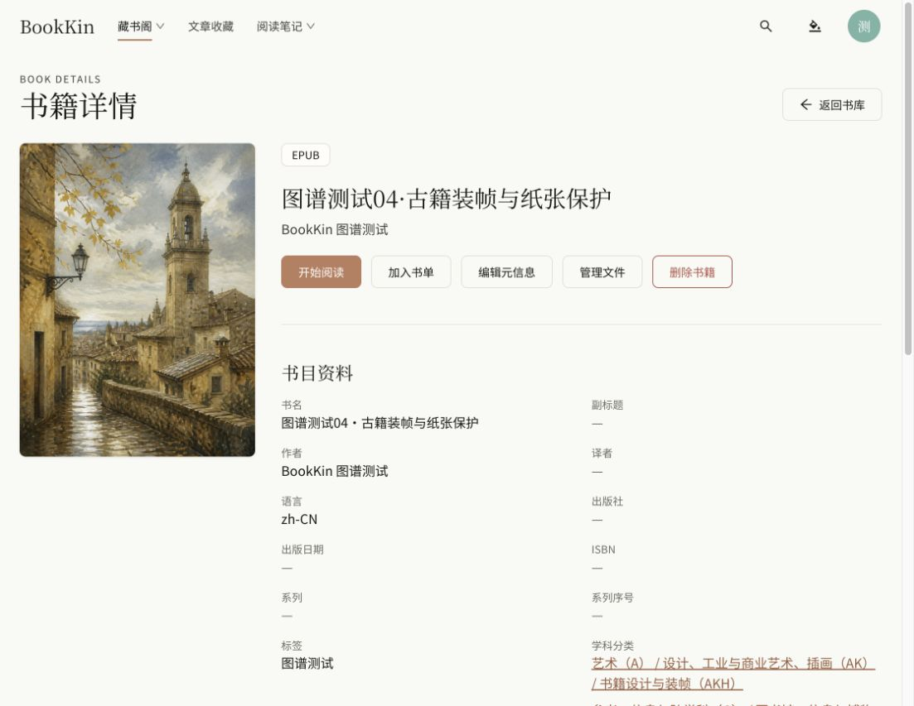
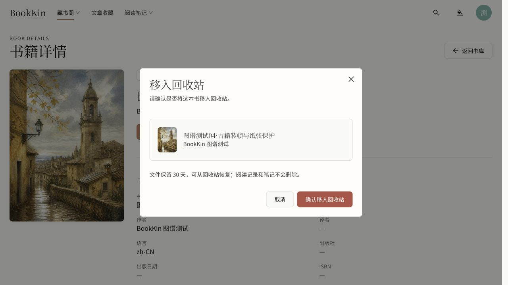

# 书籍详情删除入口验收（2026-10-22）

## 完成内容

- 在“管理文件”右侧增加红色描边“删除书籍”，仅 OWNER/ADMIN 可见，MEMBER 不显示。
- 复用 `FileOperationDialog` 的 TRASH 安全预览与二次确认：首次点击不执行删除，预览通过后才可确认；指纹、预览令牌及幂等键契约沿用现有服务。
- 确认框持续说明“文件保留 30 天，可从回收站恢复；阅读记录和笔记不会删除”。确认按钮使用语义错误红色。
- 修正共享主按钮样式覆盖危险按钮颜色的问题；危险按钮不再显示为普通品牌珊瑚色。
- 取消及提交失败留在详情；已接受的 TRASH 任务返回原书库地址和筛选，刷新相关书籍、公开目录、回收站与文件任务缓存；区分已完成和排队中提示。
- 修正一处现有阅读笔记测试向 `getByRole` 传入不支持的 `exact` 参数的问题，未改变其产品行为。

## 自动化检查

- `pnpm lint`：通过。
- `pnpm typecheck`：通过。
- `pnpm test`：154 文件、733 项全部通过。
- 相关复验：书籍详情与文件操作确认，2 文件、19 项通过。覆盖主人/管理员二次确认与取消、成员不可见、确认后提交完整预览、成功/入队返回书库、请求失败留在详情。
- `pnpm build`：通过；保留既有的大资源块警告。
- 未修改后端；未重跑 Maven。

## 浏览器验证与边界

- 实际路由：`http://127.0.0.1:4176/library/books/ab399b4b-a58c-47cc-8f9e-9af54233e80d`。
- 实际 API 安全预览成功，确认按钮可用；第一次点击仅弹窗，取消后书籍详情仍可正常显示。
- 红色入口文字/边框及实心确认按钮使用现有 error token，实测 RGB(198, 69, 69)。
- 1118×865 的批注视口及 390×844 手机视口均完成检查；按钮换行正常，无页面横向溢出，确认框可操作。已恢复原视口。
- 新预览页控制台无错误。
- 浏览器只执行安全预览和取消，没有提交真实删除。确认提交、入队和失败处理由自动化模拟测试验证；本次没有真实文件移动或删除。
- 未提交、推送或部署。

