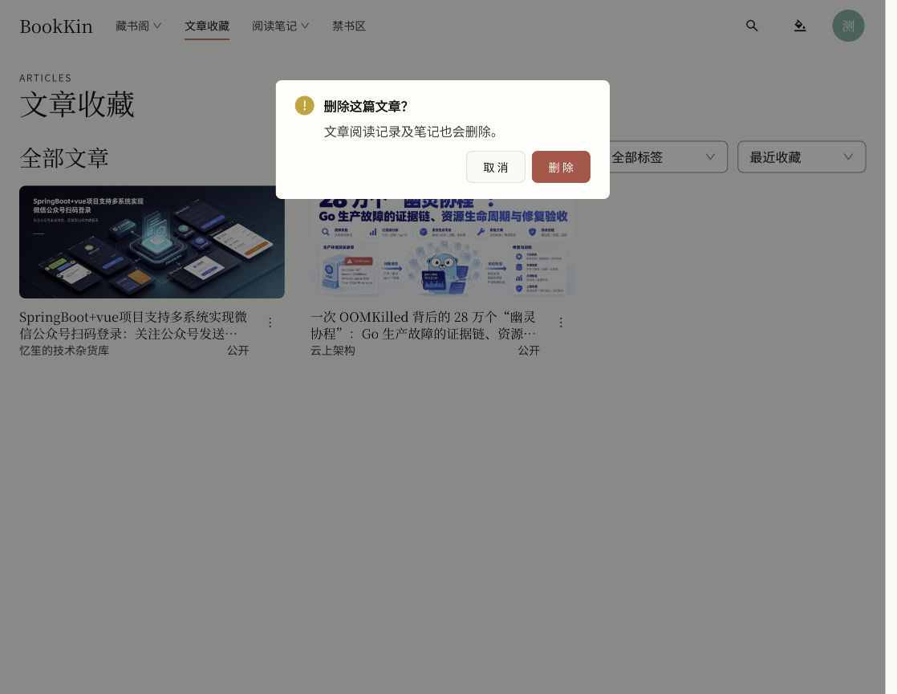
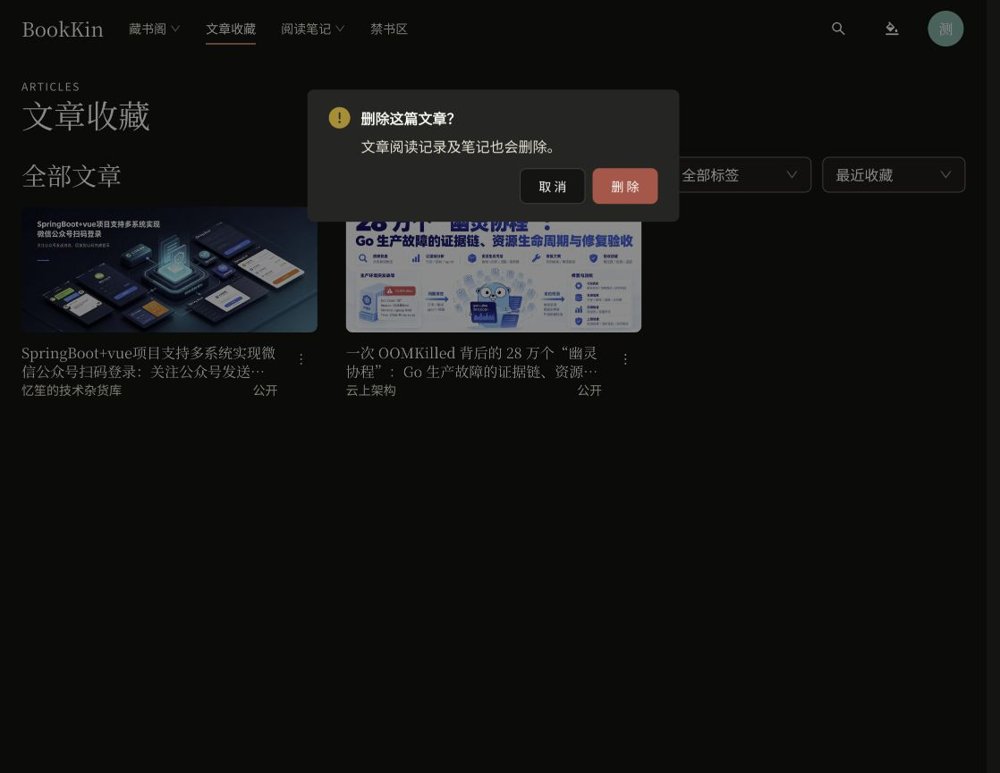

# 全局确认弹窗主题排查

全站四处命令式确认入口原先使用静态 `Modal.confirm`，不会继承页面 ConfigProvider 的主题和中文配置。页面 CSS 虽能覆盖部分按钮颜色，默认悬停、焦点、底色、圆角仍可能与全站不一致。

## 修改

- 新增 `ui/confirmations.tsx`，通过 `Modal.useModal` 将 holder 放入共享主题上下文。
- 文章删除、禁书区永久删除、清除本机解密授权、保存角色权限四处入口统一使用 `useConfirmation`。
- 删除按钮使用明确文案及 `danger` 语义红色；普通确认沿用品牌配色。
- 移除 `_AntModal` 公共导出，增加 ESLint 静态 Modal API 禁用规则，更新 AGENTS.md。
- 同时检查通知及声明式 Drawer/Dialog：已有主题内 holder 或声明式挂载，不需要更换。源码未发现界面硬编码的 Ant 默认蓝色值；阅读批注颜色与 3D 素材命名不作为品牌色缺陷处理。

## 验证

- 浏览器 `/articles` 实际打开删除确认并取消，没有执行删除。
- 纸张主题弹窗底色 `rgb(255, 253, 248)`，夜间底色 `rgb(37, 37, 35)`；圆角均为约 `7.41641px`，匹配全局 token。
- 删除按钮为 `rgb(198, 69, 69)`，匹配语义 error token；夜间文字为 `rgb(250, 249, 245)`。控制台无错误，已恢复纸张主题。
- 共享确认框 4 项测试通过，覆盖 PAPER/WHITE/NIGHT、取消不执行、已打开弹窗随主题变化。
- 文章页 16 项测试通过，含取消删除不调用 remove。取消测试按 jsdom 环境关闭主题动画，避免等待不会播放的 CSS 退出动画；不改变产品动画。
- 随后复验 EPUB 阅读器和共享确认框：共 8 项通过（其中 4 项确认框测试与上项重复）。
- Lint 通过；初始完整类型检查通过。构建时遇到本次未修改的 `ReaderPage.tsx:418`、`:419` 传入 `string | undefined` 的类型错误，构建未通过。
- 全量 `pnpm test` 在并行高负载环境运行超过 8 分钟后停止，没有完整最终结果。运行期间除已修复的取消测试外，还报告 EPUB、3D gallery、SearchPage、RevokeSessionsDialog 用例失败；EPUB 已单独复验通过，其余本次未进一步处理，不能宣称全量测试通过。
- 未提交、推送或部署；没有后端修改。

