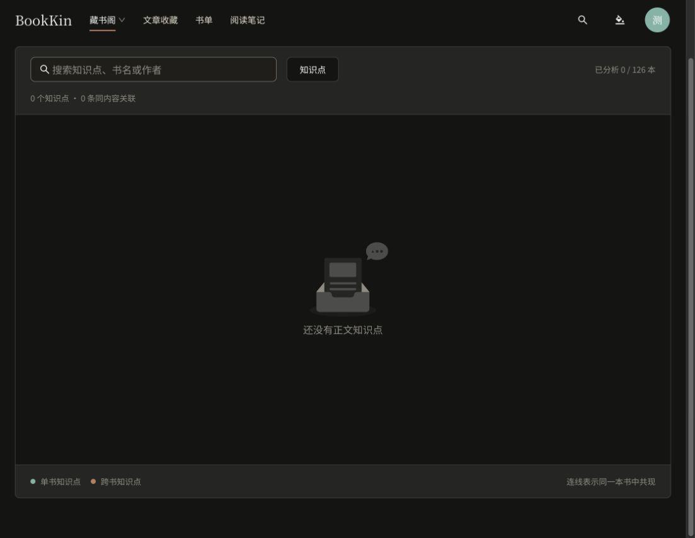

# 藏书阁知识图谱限定书籍

日期：2026-10-22。本轮遵循用户明确边界：藏书阁下的知识图谱只展示书籍正文知识点与书籍关联。替代上一版允许文章参与图谱的逻辑。

## 实现

- 移除文章知识请求、解析、节点和边合并、文章关联区以及文章加载错误提示。
- 图谱仅使用书籍知识接口及当前可访问书目 ID；书籍搜索、选中节点、相关书籍证据链接、批量分析和角色权限保留。
- 图例改为单书知识点、跨书知识点；说明连线为同一本书中共现。
- 文章收藏的数据、接口和文章自身功能保持原状；未修改后端和数据库。

| Before | After | Why |
| --- | --- | --- |
| 图谱合并书籍与文章知识 | 仅构建当前书目中的书籍知识网络 | 与藏书阁导航归属一致 |
| 节点可包含文章来源与文章引用 | 节点详情只保留相关书籍和书内证据 | 避免内容类型混入 |
| 单来源、跨来源和内容来源文案 | 单书、跨书和同一本书文案 | 清楚表达节点计数与连线语义 |

## 验证

- 前端 lint、typecheck、143 个测试文件共 653 项测试及构建全部通过；构建保留资源体积提示。`git diff --check` 通过。

- 定向组件及图谱模型测试：2 个文件、11 项通过。覆盖文章知识接口零调用、文章有知识点但书籍为空时图谱保持为空、文章服务不可用不影响书籍图谱、仅显示当前书目节点及跨书关联。
- 实际浏览器 `/knowledge-graph`：当前 126 本藏书、0 个知识点，显示真实空状态；没有相关文章，图例和连线说明均已限定书籍；无新增控制台 error。
- 当前实库没有已提取知识点，本轮未触发 AI 分析或写入测试记录；有节点时的筛选和书内引用由自动化交互测试验证。
- 未提交、推送或部署。

## 概览建议（本记录当时未实施）

后续已完成最近阅读、阅读统计和数据口径修正，见 [概览增强验收](reading-overview-recent-2026-10-22.md)。

优先增强现有分区，避免增加大量大卡片：

1. 将单本阅读进度扩为最近阅读 3 本，按当前用户最近阅读时间排序，展示真实进度并继续阅读。需要补齐最近阅读列表数据，不能将入库顺序当成阅读顺序。
2. 在现有周统计中补今日时长、本周阅读天数和日均时长，可使用现有每周每日秒数数据；零记录时如实显示零。
3. 将最近批注增强为近期 3 条批注/划线回顾，保留书名和返回原文入口；严格使用当前用户记录。

当前需先校正的概览事实：阅读进度显示的“第 7 章”为固定文案；本周新藏当前取最近入库可读书籍，尚未按实际本周日期过滤。建议与概览增强一起修正，当前概览实现未改动。

建议先做 1 和 2；全年热力图、目标打卡、推荐榜单和管理任务不优先加入。

