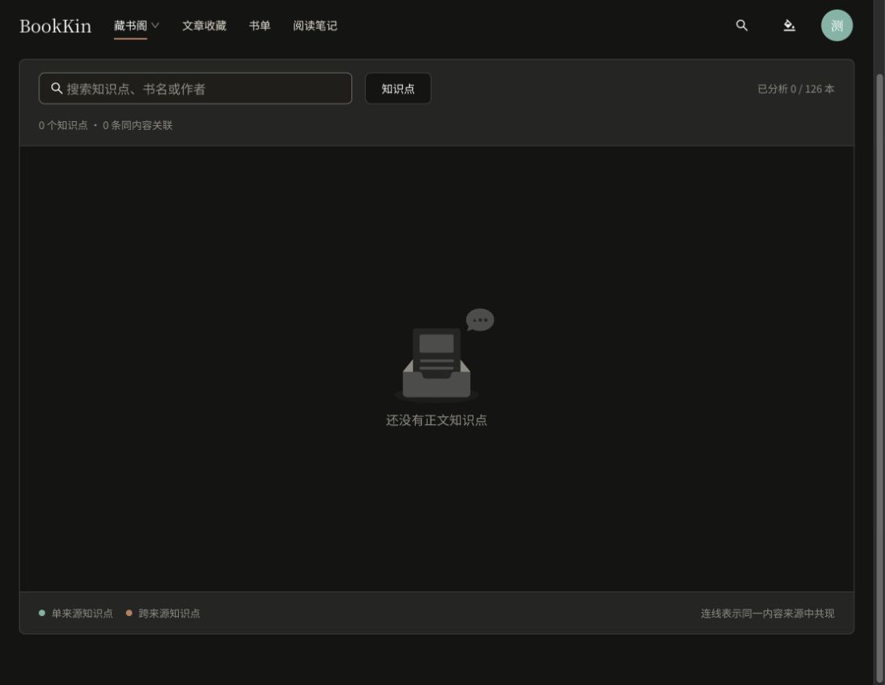

# 知识图谱相关文章显示修复

后续变更：用户进一步明确藏书阁图谱只包含书籍；本文保留此前条件过滤修复的历史记录，当前实现见 [书籍专属图谱验收](knowledge-books-only-2026-10-22.md)。

日期：2026-10-22。本地预览修复；未提交、推送或部署。未修改接口、文章数据或访问权限。

## 原因

知识图谱通过 `/api/v1/articles/knowledge` 获取当前账号可见的文章及知识点。接口会返回尚无知识点的文章。旧页面底部始终渲染“相关文章”，其条件 `!selected || ...` 允许没有选中知识点时直接显示全部可见文章，因此用户截图中的“验收示例：文章与书籍独立存储”也被列出。

## 修改

只有选中知识点后，且文章属于当前筛选图谱中的该节点来源，拥有名称匹配、原文引文和定位信息，才列为相关文章。文章结果放在知识点详情侧栏，共用已有来源卡片样式。清除选择、无匹配文章或图谱为空时不渲染该栏目。文章知识点和原文链接仍然可用。

| Before | After | Why |
| --- | --- | --- |
| 图谱为空仍列出文章收藏 | 空图谱只显示空状态 | 不把没有关联证据的收藏称为相关文章 |
| 底部全局文章清单 | 选中节点的详情侧栏中展示来源 | 与相关书籍保持相同交互逻辑 |
| 仅凭知识点名称过滤文章 | 依据当前图谱来源和完整正文证据 | 避免未分析、无引文及搜索范围外文章混入 |

## 验证

- 前端 lint、typecheck、143 个测试文件共 654 项测试及生产构建全部通过（构建保留资源体积提示）。
- 浏览器最终刷新后无新增控制台 error；`git diff --check` 通过。

- 定向测试 8 项通过，新增回归覆盖：无知识点文章不展示、选中和清除、匹配及无证据文章、搜索范围、仅文章知识点及原文链接。
- 实际浏览器刷新 `/knowledge-graph`，确认 0 个知识点时底部没有“相关文章”和验收示例链接。当前数据库没有知识节点，因此有节点时的来源筛选和链接由自动化交互测试验证，未人为触发付费分析或修改文章数据。

