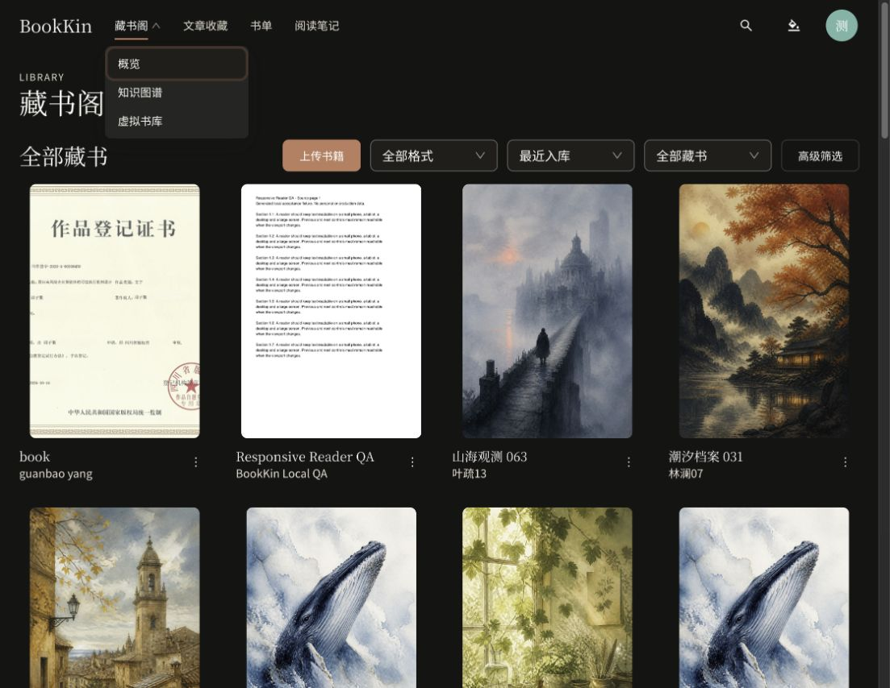
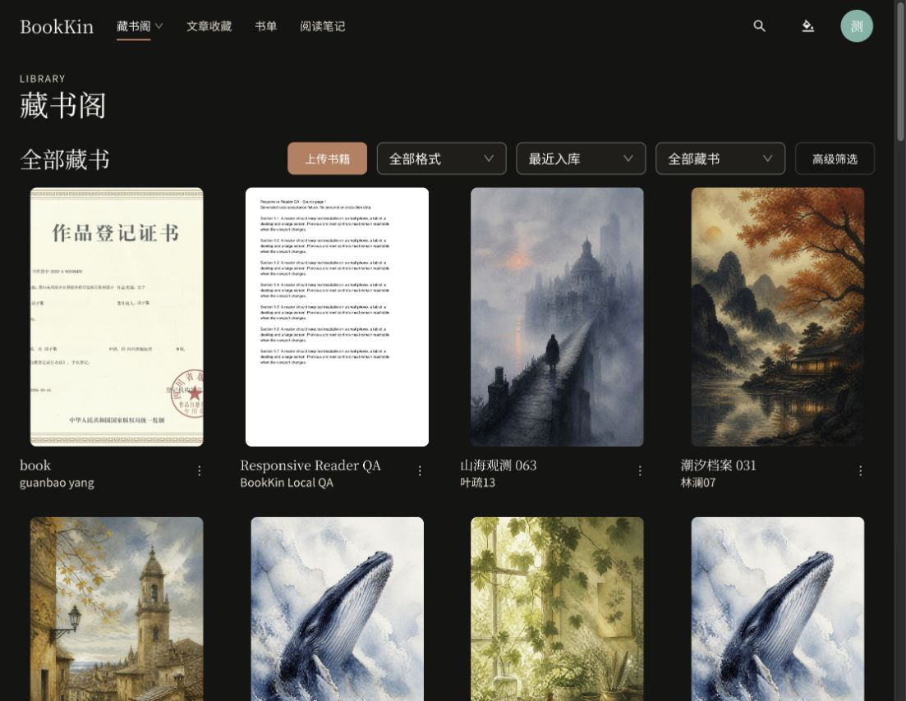

# 藏书阁父链接、悬停菜单与独立概览验收

后续概览增强已实施，见 [最近阅读与真实统计验收](reading-overview-recent-2026-10-22.md)。本文保留拆分独立概览页时的结构记录。

日期：2026-10-22。本地工作区结果，未提交、推送或部署。本文覆盖同日较早的导航、二级菜单和概览显隐规则。

## 当前页面结构

```text
藏书阁 → /library（点击父栏目直接进入全部藏书）
├─ 概览 → /library/overview（需登录）
│  ├─ 本周新藏
│  ├─ 最近批注
│  ├─ 本周阅读时长
│  └─ 阅读进度
├─ 知识图谱 → /knowledge-graph
└─ 虚拟书库 → /virtual-library（保留站点开关）
文章收藏 → /articles
书单 → /booklists
阅读笔记 → /annotations
```

桌面鼠标移入父栏目即展开上述三个子栏目，无需点击。父栏目是真实链接，保留在新标签页打开等浏览器行为；点击后关闭菜单并进入目录。支持向下方向键展开和 Escape 关闭。子页面保留父栏目选中状态。

移动端将父栏目跳转和展开箭头分为两个独立操作。全部藏书页只包含目录、上传和筛选等馆藏功能，移除四卡概览及显隐开关。旧隐藏偏好不再影响独立概览页。

匿名用户仍只能获取公开馆藏，概览不挂载、不请求私有数据；成员、管理员和主人均可进入自己的概览。上传、元数据管理、设置等既有权限未改动。概览查询使用 books 缓存前缀，保留封面和元数据变更后的统一刷新。

## 布局审查

| Before | After | Why |
| --- | --- | --- |
| 父栏目只负责打开菜单 | 父栏目直接进入全部藏书，悬停打开菜单 | 符合栏目路由与子页面层级 |
| 目录与概览混在一页，需要显隐操作 | 概览独立为受保护页面 | 目录入口直接显示藏书和筛选 |
| 二级包含重复目录入口，标签为 3D 书库 | 顺序为概览、知识图谱、虚拟书库 | 避免父子重复入口，统一用户指定命名 |
| 移动端父栏目只展开 | 父栏目跳转，独立箭头展开 | 保留触控可达性与清晰操作范围 |

## 验证

- 相关前端测试：4 个文件，55 项通过；覆盖父链接、悬停不跳转、三个子栏目顺序、键盘、移动端父子导航、虚拟书库开关、匿名权限及三个登录角色。
- 前端 lint、typecheck：通过。全量测试：143 个文件、651 项全部通过；最终构建通过（保留 Vite 的资源体积提示）。
- 后端 `./mvnw verify`：176 项，0 失败、0 错误、10 跳过（缺少 Docker 或未配置专用测试环境变量的集成测试）；新增 SPA 页面转发路径测试通过。
- API/Worker 已通过 `pnpm start:local` 更新为只读运行快照；API 健康，4176 预览可用。
- 实际浏览器：目录没有四卡概览及显隐按钮；通过指针进入父栏目（无点击）展开菜单；子栏目顺序正确；点击概览后显示四卡，刷新后仍正常；知识图谱可达、父栏目保持选中；点击父链接回到目录。
- 浏览器实际视口约 1118×865；未另外完成真实手机视口验收。移动端导航操作由自动化组件测试覆盖。虚拟书库场景内容没有变更，本轮未重新验收 3D 场景。
- 本地 8080 是 API 运行入口，未打包网页静态壳，直接访问其新旧页面地址均返回 401；页面刷新验收使用真实前端入口 4176。SPA 转发由控制器测试验证，未将其当成部署验收。

- 最终重新加载并完成页面切换后，浏览器无新增控制台 error。
- `git diff --check` 通过；未提交、推送或部署。

## 页面证据

悬停菜单：



独立概览：


全部藏书：


