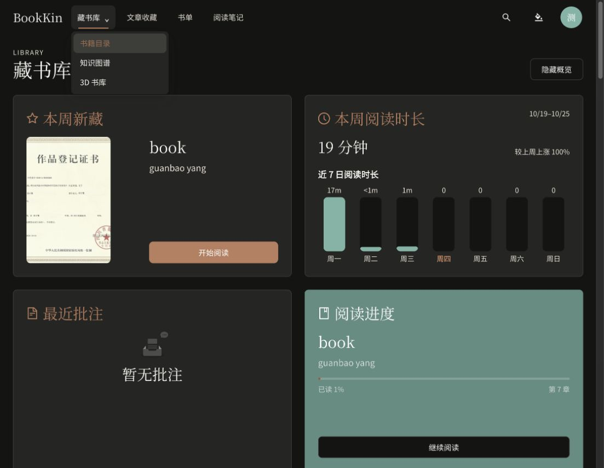

# 藏书库二级导航验收

根据浏览器截图，将知识图谱和 3D 书库纳入“藏书库”的二级导航，移除藏书库页头的重复入口。

```text
藏书库
├─ 书籍目录 /library
├─ 知识图谱 /knowledge-graph
└─ 3D 书库 /virtual-library
```

- 桌面：统一 180px 最小宽度下拉菜单，支持悬停、点击、方向下键打开及 Escape 收起；一级栏目在三个子路由及书籍详情中保持高亮。
- 手机导航抽屉：藏书库为可展开分组，子项缩进，点击子项跳转并关闭抽屉。
- 匿名：保留公开藏书库直达链接，不显示私人子项。3D 子项遵循站点功能开关。
- 页头保留概览显隐操作；书籍目录、图谱和 3D 的现有路由及访问权限保持不变。打开菜单不会预加载 3D 场景或查询其馆藏。

验证：

- `pnpm lint`、`pnpm typecheck`、`pnpm test`（142 文件，644 项）、`pnpm build` 通过；构建保留现有大资源包提示。
- 36 项定向测试通过，包含桌面跳转、父栏目高亮、键盘开关、手机分组展开/收起与跳转、匿名权限和关闭 3D 时的入口隐藏。
- 主人账户桌面浏览器实测：从二级菜单进入知识图谱、返回书籍目录、Escape 收起菜单均通过，父栏目高亮正确。
- 当前视口无横向溢出，控制台检查无 error/warn；手机实际视口未在本轮复核，分组交互由自动化测试覆盖。
- 预览保留于 `http://127.0.0.1:4176/library`。未提交、推送或部署。


