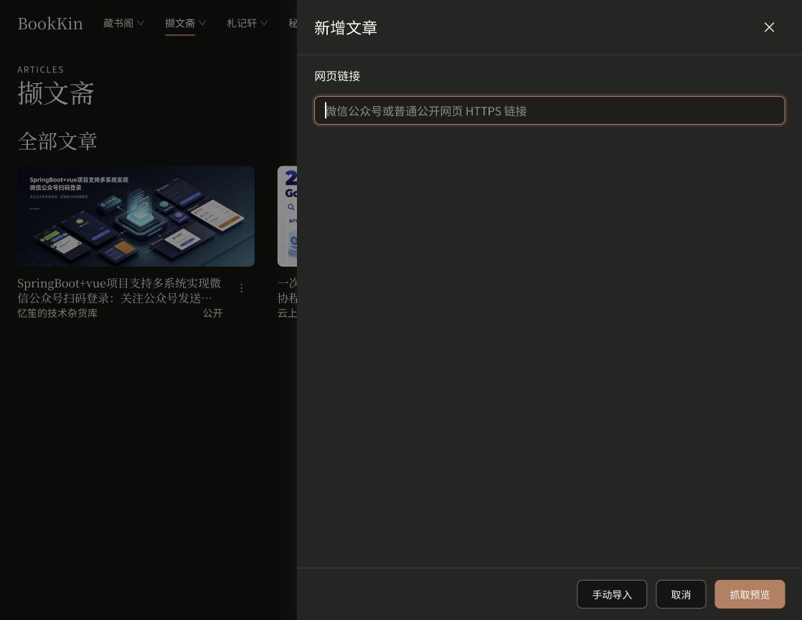
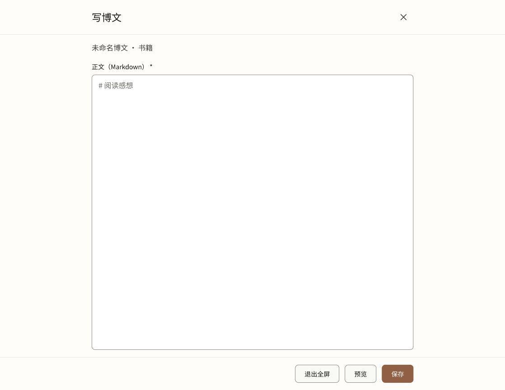
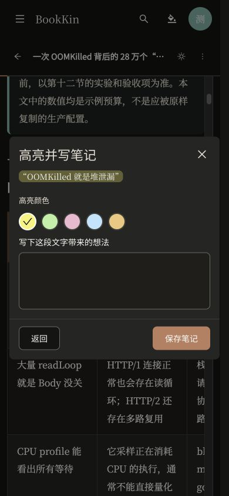
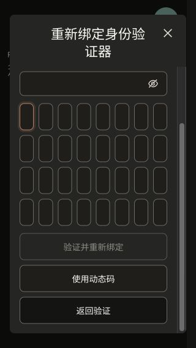

# 全站弹窗逐页验收 · 2026-10-23

## 本次修改

| Before | After | Why |
| --- | --- | --- |
| 标题内的说明也继承标题字号 | 只对嵌套 h4/h5 继承，正文保持 body2 | 保留文件操作等弹窗的文字层级 |
| 文章正文横向内距 16px、博文 20px，抽屉标题 24px | 表单使用共享 drawer gutter，桌面 24px、手机 16px | 标题与表单使用共同边线 |
| 全屏博文标题、关闭图标留在视口两端 | 标题、关闭图标、正文、按钮区对齐写作列 | 宽屏也保持共同内容边线 |
| 页面预留滚动条使部分弹窗向左偏 7.5px | Modal wrapper 和 mask 跨越完整视口变量 | 页面宽度与弹窗居中互不干扰 |

修改文件：`apps/web/src/styles.css`、`apps/web/src/features/content/content.css`、`apps/web/src/features/notes/ReadingPosts.tsx`、`apps/web/src/features/notes/notes.css`。同步更新 `apps/web/AGENTS.md`。没有新增 Token 或后端修改。

## 环境与边界

- 真实本地页面及 API。桌面 1118×865、手机 390×844；长验证表单额外检查 320×568。
- 主预览为 4176。其他并行修改触发 HMR 重置页面，中间使用当前构建的独立静态快照 4186、4187、4188，仍代理真实 API。文章、合集整理、批注及验证弹窗最后回到 4176 复核；临时快照服务器已关闭。
- 下文“通过”表示展示、视口边界、对齐、取消及所需滚动的视觉验收，不表示执行相应业务提交。
- 没有提交账户创建、角色授权、退出会话、文件恢复/清理、书目/合集、封面或批注变更。权限只调整未提交草稿以打开确认框，随后取消并重新加载，保存按钮恢复禁用。裁剪使用仓库已有公开素材，仅本地预览并取消。
- Drawer 切换尺寸存在过渡动画；最初的越界中间帧在稳定后复测正常，最终记录采用稳定尺寸。

## 逐项结果

| 弹窗／状态 | 桌面 | 手机 | 记录 ID |
| --- | --- | --- | --- |
| 上传书籍 | 通过 | 通过 | book-upload |
| 加入书目，长标题 | 通过 | 通过 | add-to-booklist |
| 新建书目 | 通过 | 通过 | booklist-create |
| 移入回收站 | 通过 | 通过 | book-trash-confirm |
| 管理分类／新建 | 通过 | 通过 | category-manage |
| 管理分类／编辑 | 通过 | 通过 | category-edit |
| 删除分类确认 | 通过 | 通过 | category-delete-confirm |
| 编辑书目 | 通过 | 通过 | booklist-edit |
| 删除书目确认 | 通过 | 通过 | booklist-delete-confirm |
| 整理书目 | 通过 | 通过 | booklist-organizer |
| 新增文章 | 通过 | 通过 | article-capture |
| 手动导入文章 | 通过 | 通过 | article-import |
| 编辑文章 | 通过 | 通过 | article-edit |
| 加入合集，长标题 | 通过 | 通过 | article-add-collection |
| 新建合集 | 通过 | 通过 | article-collection-create |
| 删除文章确认 | 通过 | 通过 | article-delete-confirm |
| 编辑合集 | 通过 | 通过 | article-collection-edit |
| 删除合集确认 | 通过 | 通过 | article-collection-delete |
| 整理合集 | 通过 | 通过 | article-collection-organizer |
| 创建家庭账户 | 通过 | 通过 | user-create |
| 调整用户角色 | 通过 | 通过 | user-role |
| 退出全部会话 | 通过 | 通过 | sessions-revoke |
| 回收站恢复预览 | 通过 | 通过 | recycle-restore |
| 回收站永久清理预览 | 通过 | 通过 | recycle-purge |
| 重命名书籍 | 通过 | 通过 | book-rename |
| 恢复默认封面 | 通过 | 通过 | cover-reset |
| 裁剪封面 | 通过 | 通过 | cover-crop |
| 阅读器目录 | 通过 | 通过 | reader-toc |
| 阅读器笔记 | 通过 | 通过 | reader-notes |
| 高亮并写笔记 | 通过 | 通过 | reader-note-composer |
| 正文分析 | 通过 | 通过 | knowledge-analysis |
| 写博文 | 通过 | 通过 | post-editor |
| 写博文／全屏 | 通过 | 通过 | post-editor-fullscreen |
| 虚拟书库检索 | 通过 | 通过 | virtual-library-search |
| 保存角色权限确认 | 通过 | 通过 | role-permissions-save |
| 移动导航 | 不适用 | 通过 | mobile-navigation |
| 身份验证／动态码 | 通过 | 通过 | vault-verification |
| 身份验证／备用码 | 通过 | 通过 | vault-recovery |
| 重新绑定／备用码表单 | 通过 | 通过 | vault-rebind-recovery |
| 重新绑定／动态码表单 | 通过 | 通过 | vault-rebind-code |

共 40 种状态、39 个桌面视图、40 个手机视图。几何记录见 [results.json](modal-page-audit-2026-10-23/results.json)。完整截图位于本机 `.local/verification/modal-page-audit-2026-10-23/`，文件名为 `记录ID-desktop.png`、`记录ID-mobile.png`。部分早期截图使用旧“文集”文案，当前路由文案已由并行修改统一为“合集”；本次没有修改命名。

## 补充检查

- 320×568 长验证表单：弹窗 288×520，x=16、y=24；标题和关闭图标固定可见，仅正文滚动，底部按钮可达。
- 最终全屏博文：标题和正文 x=203；关闭按钮、正文、底部操作区右边线均为 x=915。
- 修复后的批注弹窗：桌面宽 360、x=379（1118 视口）；手机宽 358、x=16（390 视口）。
- 虚拟书库检索保留搜索弹层形态，没有独立标题和关闭按钮，Escape 可关闭；搜索和结果按钮两端正常。
- 源码检查：个人资料、书库目录、阅读字体、安全设置等页面当前使用内联表单，没有额外独立 Modal。

## 尚未实测的条件状态

| 状态 | 已检查 | 未触发原因 |
| --- | --- | --- |
| 临时密码“只显示这一次” | 使用共享 DialogTitle/Content/Actions，无额外外层内距 | 需要实际创建账户或重置凭据，本次未执行 |
| 秘藏阁书籍永久删除确认 | 使用共享 useConfirmation | 用户手动验证后实际目录为空，没有可打开条目 |

首次绑定二维码和备用码生成是页面内卡片，不属于弹窗；没有执行绑定或生成。没有有效路由入口的旧批量重命名、旧封面上传、展示书目和分类详情抽屉仅核对继承关系，不计入浏览器通过项。

## 自动检查与控制台

- `pnpm lint && pnpm typecheck && pnpm test && pnpm build` 退出 0：176 个测试文件、862 项测试通过。日志：`.local/logs/modal-page-audit-web-gates.log`。
- 最后的 CSS 修正后再次运行 lint、typecheck、build，均退出 0。日志：`.local/logs/modal-page-audit-centering-checks.log`。没有重复完整单元测试；CSS 几何通过浏览器复核。
- jsdom CSS、canvas、伪元素模拟警告，以及构建 chunk-size 警告未造成失败。
- 检查中 API 重启曾出现临时 502，HMR 曾记录 AuthProvider 边界错误。恢复/重载后正常；最终原预览批注弹窗桌面与手机复核期间未新增 error 日志。没有把历史日志描述成已修复的业务缺陷。
- 未提交、推送或部署；后端未改动，本次未运行 Maven。原预览和 API 健康检查均返回 HTTP 200。

## 关键截图

