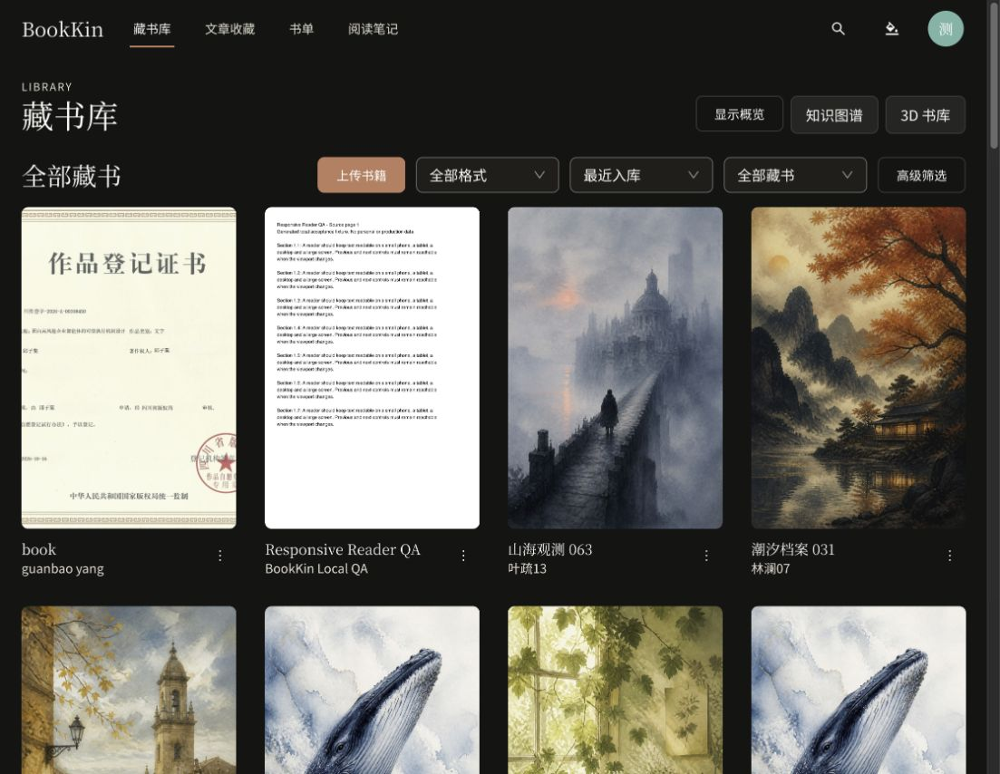
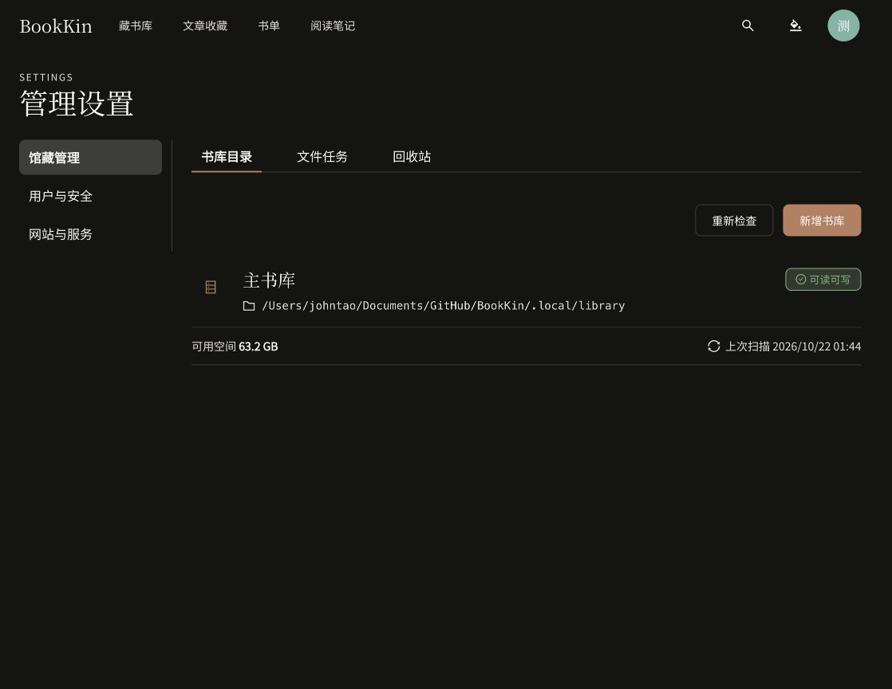

# 首页、导航及管理设置合并验收

日期：2026-10-22。范围为前端页面组织与入口调整，未修改本轮之外的业务能力或服务端授权。

后续根据浏览器批注，知识图谱与 3D 书库入口已进一步移入“藏书库”二级菜单，见 [二级导航验收](library-secondary-menu-2026-10-22.md)。下文保留首次合并时的验收快照。

## 完成结构

```text
主导航
├─ 藏书库 /library
│  ├─ 匿名：公开目录
│  ├─ 登录：全部可访问藏书 / 公开藏书
│  ├─ 阅读概览、筛选、上传与管理操作按原权限保留
│  └─ 知识图谱、按站点开关显示的 3D 书库入口
├─ 文章收藏
├─ 书单
└─ 阅读笔记

个人菜单
├─ 个人信息
├─ 禁书区
├─ 管理设置（主人/管理员）
│  ├─ 馆藏管理：书库目录 / 文件任务 / 回收站
│  ├─ 用户与安全：用户列表 / 在线会话 / 登录日志 / 安全设置
│  └─ 网站与服务：网站设置 / 阅读字体 / 邮件服务 / AI 书目匹配
└─ 退出登录
```

匿名导航仅显示藏书库、书单。网站设置和邮件服务仅主人可见；安全编辑与永久清理继续由原组件及服务端执行主人限制。文章、禁书区、知识图谱和 3D 书库继续要求登录。文章与普通书籍笔记的汇总、阅读交互统一等后续工作未在本轮实施。

## 兼容与数据边界

- `/library/all`、`/display-books`、`/settings/display-books` 保留认证入口，跳转到 `/library` 并保留查询参数、hash 和路由状态。
- 原分类链接跳转到统一藏书库的高级筛选，保留分类及其他查询条件。
- 旧设置 hash 由 `settings-navigation.ts` 映射：书库、文件任务、回收站进入馆藏管理；字体、网站、邮件、AI 进入网站与服务；会话、登录、安全仍进入用户与安全。
- `/admin/users`、`/admin/file-operations`、`/admin/library-roots`、`/admin/reader-fonts` 与回收站旧入口继续可用。
- 只有当前允许的设置面板会挂载。成员不会挂载管理面板，管理员不会挂载主人专属服务配置。
- 匿名统一入口即使携带 `scope=all`，也只调用公开书目接口；不会请求私人馆藏及阅读统计。登录后的公开范围也使用公开目录接口。

## 自动化验证

- `pnpm lint`：通过。
- `pnpm typecheck`：通过。
- `pnpm test`：142 个测试文件、640 项测试通过。
- `pnpm build`：通过，Sites 输出准备成功；构建存在资源包大于 500 kB 的提示。
- 覆盖 OWNER / ADMIN / MEMBER 权限、匿名入口不请求私人目录、馆藏范围切换保留筛选条件、旧路由及 hash、浏览器历史、仅挂载当前面板、成员禁止访问回收站。
- 同时修正原文章测试中的 Testing Library `getByRole` 不支持 `exact` 参数问题，改用锚定名称正则，保留原匹配意图。

## 真实预览验证

- 执行 `pnpm start:preview`，复用本仓库健康服务；API/Worker 使用 `pnpm start:local` 创建的不可变 JAR 快照。
- 前端：`http://127.0.0.1:4176/library`。API 健康检查：`http://127.0.0.1:8080/actuator/health`。
- 浏览器使用已有主人测试账户，确认四项主导航、头像菜单禁书区/管理设置入口、全部与公开范围切换、三个管理分组、用户列表、回收站可达。
- 桌面视口约 1118×865，无页面横向溢出；控制台检查未发现 error/warn。
- 临时隐藏概览取得截图后已恢复原来的显示状态。预览标签已标记为交付物保留。
- 管理员、成员、匿名状态在本轮通过自动化测试覆盖，未另行做真实浏览器登录验收；手机实际视口未验证。
- 浏览器验证仅浏览与切换，没有执行删除、权限修改、邮件发送或 AI 正文分析。

截图：





本轮未提交、推送或部署。工作区原有其他未提交修改保留。
