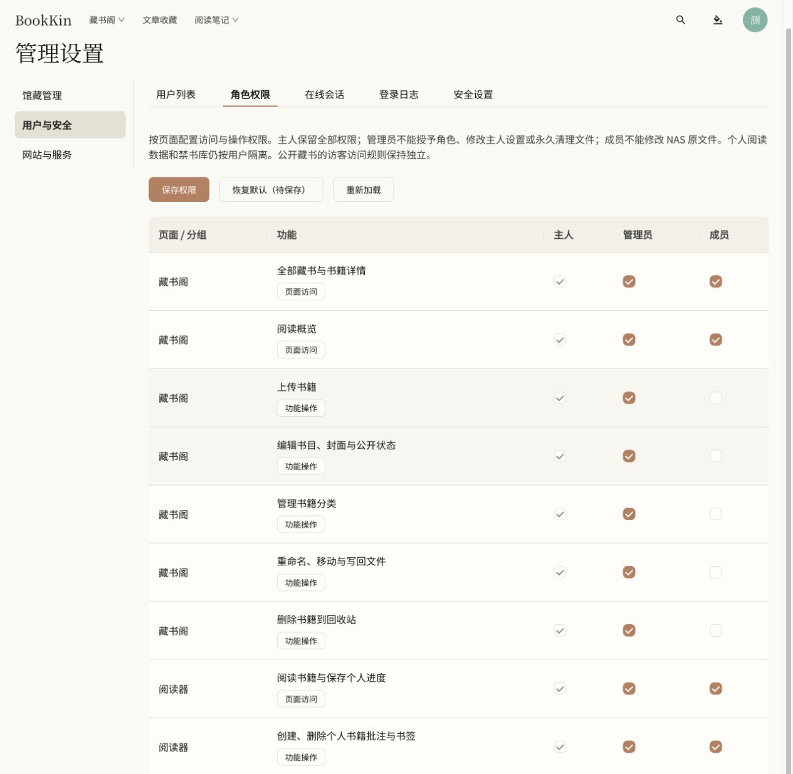
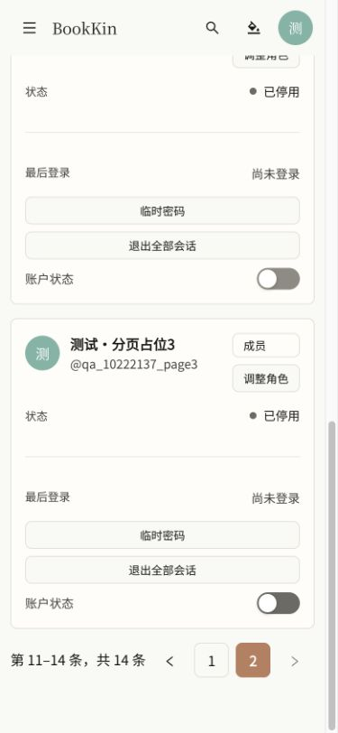
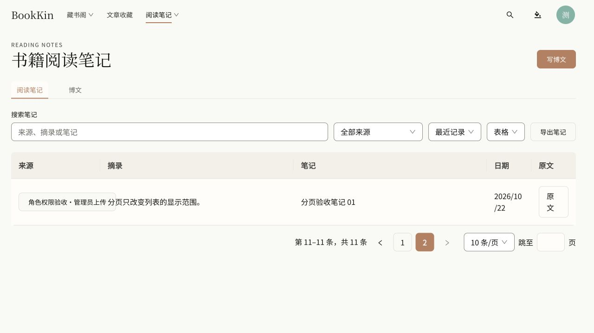
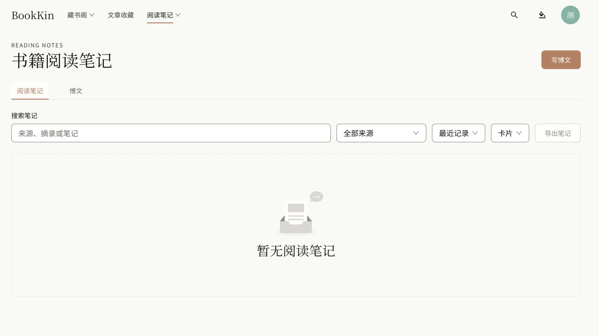

# 全局表格分页与角色实登验收

验收日期：2026-10-22；本地预览：http://127.0.0.1:4176/settings#users/roles 。

## 实现范围

角色权限、用户管理、在线会话、登录日志、回收站、阅读笔记、文件任务共 7 处数据表，统一使用原生 Ant Design Table / Pagination。默认每页 10 条，可选 10、20、50、100 条，显示当前范围与总数，支持跳页，分页位于底部右侧，使用中文语言包和响应式布局。依据：[Table 分页](https://ant.design/components/table/#pagination)、[Pagination](https://ant.design/components/pagination/)。

文件任务增加服务端分页、准确总数与稳定排序，保留旧版最近任务接口兼容。登录日志保留服务端分页。其他本地集合交由 Ant Table 分页；用户移动端卡片与桌面表格共享分页状态。筛选和修改每页条数回到首页；总数减少时自动收敛到有效页；角色配置草稿跨页保留。

## 自动验证结果

| 检查 | 结果 |
| --- | --- |
| 前端 Lint、类型检查 | 通过 |
| 前端完整测试 | 161 个测试文件，762 项通过 |
| 回收站筛选重置的最后一处调整 | 定向 3 项通过，随后 Lint、类型检查、构建通过 |
| 前端生产构建 | 通过；保留大于 500 kB 的分包体积提示 |
| 后端 Maven verify | 228 项：219 通过、9 跳过，0 失败、0 错误 |
| 后端跳过原因 | Docker 不可用，9 项依赖 Testcontainers 的测试跳过 |
| 原生 PostgreSQL 文件任务分页 | 121 条隔离测试记录，跨 13 页无遗漏、无重复，验证末页及空页 |
| 分页参数校验 | 负数、超限、非数字及溢出参数返回 400；不误报未登录 |
| Git diff 空白检查 | 通过 |

API / Worker 通过 `pnpm start:local` 运行不可变快照 `.local/run/bookkin-20261022-220157-27773.jar`；API 健康状态为 `UP`。

## 真实登录与操作验证

| 身份 | 浏览器操作及结果 |
| --- | --- |
| 主人 | 角色权限共 43 条，分页、跳页可用；修改草稿跨页保留，重新加载后丢弃草稿，未发布权限变更。用户共 14 条，第 2 页为 4 条；切换每页 20 条返回第 1 页。 |
| 管理员 | 实际登录、上传原创测试 EPUB、确认入库、编辑出版社并保存成功。用户列表分页可用，不能修改角色；直接访问角色权限页面为 403。登录日志、在线会话、文件任务分页正常。 |
| 成员 | 实际登录、打开测试 EPUB 阅读、保存书签、创建私人书单成功。书籍编辑、文件管理、删除及上传入口隐藏；直接访问编辑页和用户管理页为 403。 |
| 成员笔记 | 11 条笔记，第 2 页只有 1 条；在第 2 页搜索唯一笔记后回到第 1 页并显示 1 条。 |
| 私人数据隔离 | 管理员重新登录后看不到成员笔记、书签和私人书单。API 伪造 userId 仍不能读取成员数据。成员元信息修改、上传、回收站预览接口均返回 403。 |
| 禁用账号 | 登录返回 401。 |
| 移动端 | 390 × 844 视口下用户第 2 页显示 4 张卡片，分页可用，页面无横向溢出。 |
| 控制台 | 最终新打开的预览页面无控制台错误。 |

主人原有登录保留在 `127.0.0.1`；测试账号使用 `localhost:4176` 的独立 Cookie 环境。

## 保留的测试资料

- 2 个可登录账号：`qa_10222137_admin`（管理员）、`qa_10222137_member`（成员）。初始改密流程已完成。
- 9 个已禁用的成员账号，仅用于用户表翻页验收。
- 1 本原创测试书：`角色权限验收·管理员上传`，ID 为 `e49779f6-7ac1-4d78-b280-0e2aba155063`。
- 成员自己的 11 条笔记、1 个通过阅读器保存的书签、1 个私人书单。

测试账号密码仅保存在本机被 Git 忽略的 `.local/role-pagination-qa/测试账号.md`，文件权限为 600。报告和截图不包含密码。现有用户、已发布角色权限未更改；未提交、推送或部署代码。

浏览器验收覆盖上述核心流程；未调用付费 AI、发送邮件或对原有书籍执行永久清理。

## 截图证据

主人角色权限分页：

移动端用户第 2 页：

成员笔记第 2 页：

管理员访问角色权限被拒绝：

管理员自己的笔记列表未混入成员笔记：

