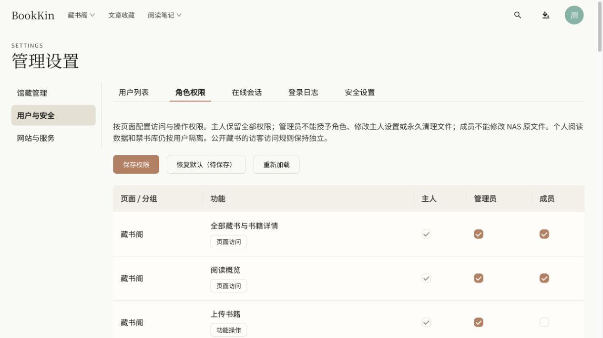
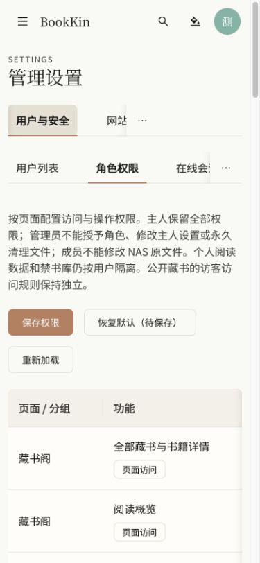

# 全局角色权限验收（2026-10-22）

## 交付

入口：管理设置 → 用户与安全 → 角色权限，预览地址为 http://127.0.0.1:4176/settings#users/roles。

- 用共享 `role-permissions.json` 定义 20 个分组、43 项页面/功能权限；前端与服务端读取同一目录。
- 主人权限固定。主人可配置管理员和成员权限；关闭页面会联动关闭依赖它的功能，开启功能会补齐所需页面。恢复默认先进入草稿，保存需确认。
- 用户列表增加“调整角色”：主人可在成员和管理员之间调整已有非主人账户；保留账户启用状态、首次改密标记和所有权。使用 expectedRole 拒绝过期修改，记录审计。
- 服务端每次 API 请求读取当前数据库角色与权限，覆盖旧会话中的角色，不依赖隐藏菜单。配置保存使用 revision 防止覆盖其他修改，追加 Flyway V25 持久化配置。
- 菜单、直接路由、设置分区、主要操作入口与全局搜索使用有效权限。受限路由在子页面请求挂载前拦截；权限加载失败不放行，撤权后清理相关查询缓存。前端约 10 秒同步配置，后端后续请求立即校验。
- 文件操作在预览和执行时按真实操作类型分别授权，旧预览和幂等请求不能绕过撤权；原有路径、指纹、确认、幂等及回收流程保留。
- 阅读位置、批注、书评及禁书库仍按用户隔离。管理员不能修改主人、安全策略、SMTP 或角色权限，永久清理仍仅主人可执行；成员不能写 NAS 原文件。公开访客发现/阅读独立于登录角色配置。

## 自动验证

| 检查 | 最终结果 |
| --- | --- |
| `pnpm lint` | 通过 |
| `pnpm typecheck` | 通过 |
| `pnpm test` | 160 个文件，760 项通过，0 失败 |
| `pnpm build` | 通过；保留现有大体积 chunk 提示 |
| `apps/server/./mvnw verify` | 218 项：209 通过，9 跳过，0 失败/错误 |
| `git diff --check` | 通过 |

后端验证使用本机 PostgreSQL 的随机隔离 schema，结束后清理；没有修改真实用户的角色或实际权限配置。9 项跳过属于缺少 Docker 的 Testcontainers 用例，不算通过。

新增测试覆盖：配置持久化/冲突/审计、角色上限、页面依赖、主人不可降级、非主人不能提权、历史会话降权、禁用账户、撤权后的文件预览执行、控制器 API 路由分类覆盖、权限加载/失败门禁、撤权后卸载页面和清缓存、请求去重、导航/操作分离、编辑器依赖联动、角色调整取消及被关闭的搜索源。

## 浏览器与运行时

- 真实主人会话打开权限矩阵：43 行、129 个角色复选框；主人及越界权限锁定。
- 验证修改草稿、依赖联动、保存确认弹窗和取消，重新加载后恢复原配置，保存按钮禁用。
- 真实用户列表显示管理员/成员的“调整角色”入口，打开并取消调整弹窗。未在实际账户上提交角色变更。
- 桌面与 390×844 手机视口检查；手机表格可在内部横向滚动，页面无横向溢出。恢复原视口，保留最终预览标签页。
- 最终页面控制台错误：0。
- `pnpm start:local` 已启动 API/Worker，不可变快照：`.local/run/bookkin-20261022-212125-18324.jar`。API 健康状态 UP，4176 预览返回 200。
- 管理员/成员权限与越权场景由自动化测试验证；本轮未使用这些实际账户登录浏览器。

桌面截图：

手机截图：

未提交、推送或部署本轮修改。
