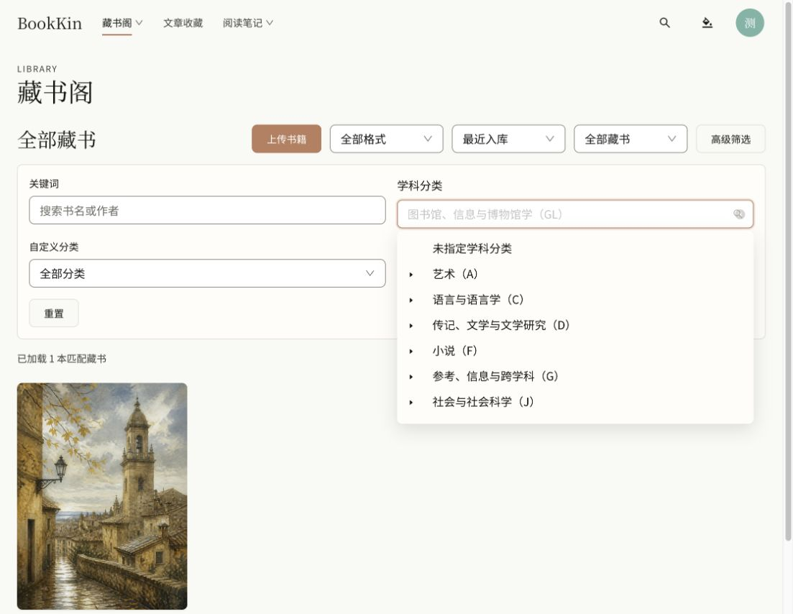

# Thema 中文学科分类验收（2026-10-22）

## 交付

- 中文界面字段统一为“学科分类”，提示为“第一项为主要学科”；覆盖上传、编辑、详情、建议及登录/公开书库共用筛选组件。
- 3,422 个 A–Y 类目均具有中文显示名称；中文层级路径不再混排英文原名。标准代码、父子关系、主分类顺序、既有书籍数据和权限不变。
- 新增 `apps/web/src/domain/thema-zh-CN.json`，与原始 1.6 英文目录按代码一一对应；英文原名及祖先名称仍可搜索，支持中文及代码搜索。
- 数据以 [EDItEUR Thema 英文目录](https://ns.editeur.org/thema/en) 为基础，使用 Google Translate 生成中文初译，人工校正根类、常用类别和部分专业术语。这是 BookKin 项目中文展示译名，非官方中文版本，也未经过全部专业学科逐条人工审定。技术产品名称（如 Linux、.NET）保留通用专名。分类展示无需运行时联网翻译。

## 验证

- 中文覆盖检查：3,422 / 3,422，无缺失、无多余代码；每项包含中文，版本与原始目录一致。
- `pnpm lint`、`pnpm typecheck`、`pnpm build` 通过。构建仍有既有的大资源块提示。
- 初次全量测试：153 个文件，151 个通过；725 项断言中 723 项通过、2 项失败。其中书籍详情的旧中英混排预期已更新并通过复验。
- 本次相关复验：`thema.test.ts`、`ThemaSubjectField.test.tsx`、`CatalogAdvancedFilters.test.tsx`、`BookDetailPage.test.tsx`，4 文件、25 项全部通过。
- 尚未通过的独立断言：`AppShell.test.tsx` 仍要求桌面和手机菜单含“书籍+文章”，而当前工作区 `notesSections` 只有“书籍”“文章”。本次未修改该导航或其测试，未将全量测试宣称为全部通过。
- 实际浏览器：中文“图书馆”搜索正常；英文“Restoration ecology”返回中文“生态修复与再野化（RNKH2）”，选中后正确筛出测试书。返回 GL 过滤后，打开详情与编辑页，名称和已保存分类正确；返回书库仍保留 GL。
- 手机 390×844：页面内容宽度与视口均为 375，无横向溢出。已恢复原视口。
- 浏览器捕获到一条 TreeSelect 底层 `rc-virtual-list scrollTo` 警告；未影响所验证的搜索、选择、筛选和返回交互。
- 未变更后端，未重新上传书籍、写回原文件、提交、推送或部署。

预览：`http://127.0.0.1:4176/library?advanced=1&subject=GL`

