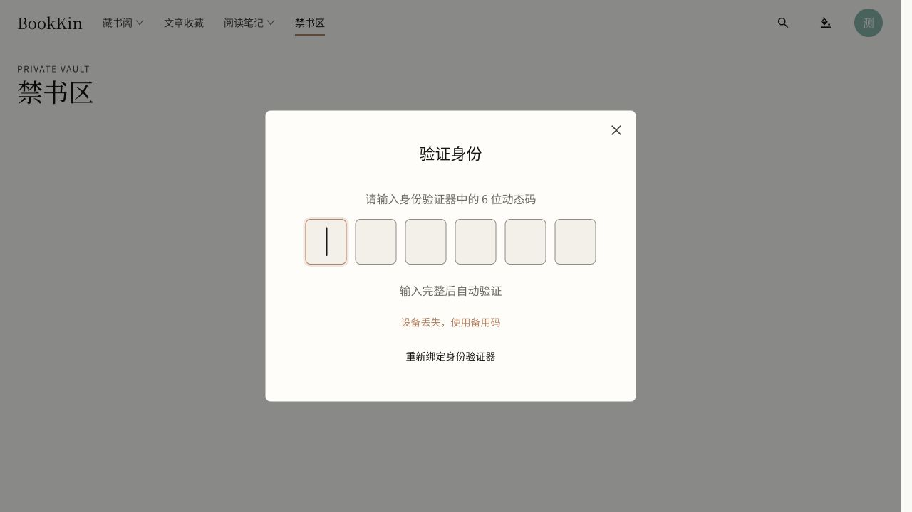
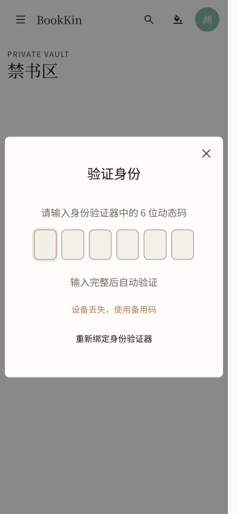

# 禁书区六格验证码样式验收

日期：2026-10-23。预览：http://127.0.0.1:4176/vault 。

按用户参考图，将已绑定账号的身份验证改为居中弹窗与六个独立数字格。使用原生 Ant Design Input.OTP，沿用当前主题和设计 Token；提示为身份验证器动态码，不包含邮件发送或重发文案。绑定确认也复用六格输入，但保持用户主动确认绑定。

访问验证码输满六位后自动验证，提交期间禁用输入，重复提交受保护。支持整段粘贴、数字过滤、键盘移动；失败或超时后清空并聚焦第一格。保留备用码、重新绑定入口，关闭弹窗撤销访问授权并返回藏书阁。原有服务端权限、加密密码和解密恢复密钥流程保留。

## 验收结果

- 定向交互测试 9 项通过：数字粘贴分配、完整码回调、键盘与焦点、错误重试、无障碍弹窗、绑定和备用码、锁定及过期响应隔离。
- 前端全量测试 781 项通过。
- 最终类型检查、Lint 与生产构建通过；构建保留已有的大分包体积提示。
- 真实测试账号：点击「禁书区」弹出六格输入；错误码自动提交后显示错误，六格清空并回到第一格；正确验证码整段输入后自动进入原有加密流程；锁定后再次要求验证，关闭弹窗返回 `/library`。
- 实际验证页面控制台无错误。后台标签测试曾出现请求超时，前台重测同一真实接口正常；超时场景同样清空输入，可重试。
- 390 × 844 手机视口中，六格各约 37 × 50，页面宽度 375，不超出视口。桌面恢复默认视口后六格保持正常比例。
- 未改变主人账号的绑定、密码、恢复码或管理开关；交互请求使用独立的本地成员测试账号。

补充边界：全库构建一度被同时修改的文章页测试查询参数类型错误阻止，最终源文件已恢复兼容并构建通过。额外文章页定向复验中有 2 项触及 15 秒超时，13 项通过；这不计为通过，本报告的 781 项全量通过和 9 项验证码定向通过分别来自对应运行。验证码相关代码在这些检查后未再修改。

桌面：

手机：

